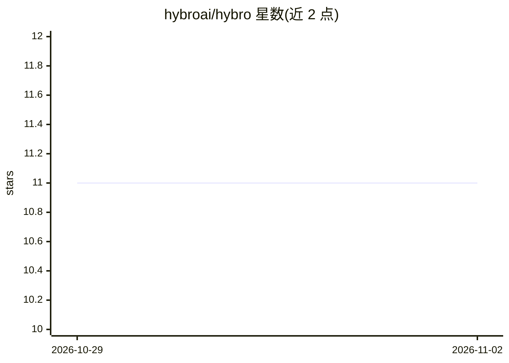

# hybroai/hybro

⭐ 11 · Python · Apache-2.0 · 推送 2026-11-01 · [GitHub](https://github.com/hybroai/hybro) · [官网](https://hybro.ai) · 组织维护

**开源多智能体互操作平台：编排本地与远程 AI Agent 协同**

基于异步 FastAPI 后端与 Next.js 仪表盘的多智能体平台，围绕 Agent2Agent (A2A) 协议实现协议无关的消息路由，支持本地与云端 Agent 混合编排、多 Agent 执行室、SSE 实时流式消息与 A2A Agent Inspector 调试。通过 npm CLI 或源码脚本安装，依赖 Docker Compose 运行，setup 时配置 OpenAI/DeepSeek/Anthropic API key。内置 MCP 网关（无认证，仅限可信本地环境）与四个示例 Agent。

## 筛选速览

| 维度 | 判定 | 备注 |
|---|---|---|
| AI 角色 | `ai-ecosystem` | LLM/agent 周边工具 |
| 许可风险 | `permissive` | Apache-2.0 |
| 部署形态 | `self-host` | docker 或自建部署 |
| 模型依赖 | locked-api |  |
| 硬件要求 | — | 无带数字的原话,不猜 |
| 安装摩擦 | `low` | 无编译、无系统依赖或容器化 |
| 成熟度 | — | 结构信号不足 |

## 能力要点

- 基于 A2A 协议的本地/远程 Agent 互操作与编排
- 多 Agent 执行室与实时 SSE 消息流、Inspector 调试
- CLI 统一管理配置与模型认证（~/.hybro/ JSON）
- 内置 MCP 网关，可接入 Claude Code/Cursor/VS Code 等客户端

## 适用场景

- 我把多个本地和云端 Agent 接入同一网络协同完成多步骤任务
- 通过聊天界面调度多个 Agent 并实时查看各自的响应
- 用 MCP 客户端连接 Hybro 作为工具服务器

## 场景标签

`Agent 框架` `多智能体` `模型网关` · 领域:Agent 开发

## 证据(README 行号)

> L16: Hybro AI is an open-source, hybrid multi-agent platform built for seamless agent interoperability. It serves as the
> L23: Hybro AI allows developers and teams to deploy, coordinate, and inspect clusters of autonomous AI agents. Powered b
> L27: - **Native Agent Interoperability**: Built around the open Agent2Agent (A2A) protocol for standardized inter-agent 

## 星数曲线

2026-10-29 11 → 2026-11-02 11（+0）

---
*卡片 v1 · prompt 1.4 · 生成 2026-11-02 · 置信度 high · 依据 README sha `daa0f77cb16b` · [字段定义](../../DATASET.md)*
