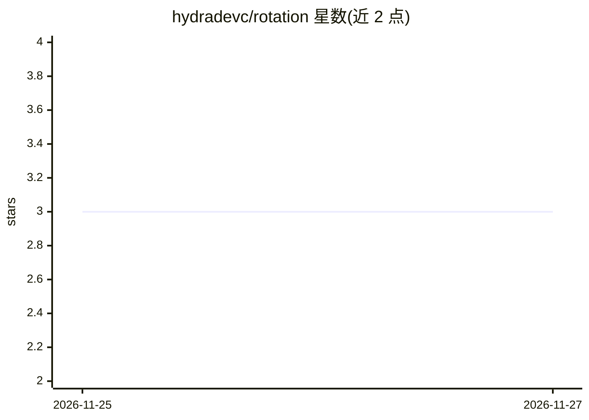

# hydradevc/rotation

⭐ 3 · JavaScript · MIT · 推送 2026-11-20 · [GitHub](https://github.com/hydradevc/rotation) · 个人维护

**自托管 API key 轮换池网关：多 key 合成一个端点**

HYDRA 是一个 Node.js 编写的自托管密钥轮换代理：将多个 OpenAI 兼容与 Anthropic 的 key 纳入统一池，对外暴露单一端点，把速率限制分摊到整个池上。提供四种 key 选择策略、429/5xx 失败转移、熔断与排队等待、按应用分配的访问 key、密钥 AES-256-GCM 静态加密、Prometheus 指标、双语管理面板。零依赖纯 Node ≥20，支持 git clone 直接运行、Docker 与 systemd 部署，也可在 Android/Termux 运行。

## 筛选速览

| 维度 | 判定 | 备注 |
|---|---|---|
| AI 角色 | `ai-ecosystem` | LLM/agent 周边工具 |
| 许可风险 | `permissive` | MIT |
| 部署形态 | `self-host` | docker 或自建部署 |
| 模型依赖 | locked-api |  |
| 硬件要求 | — | 无带数字的原话,不猜 |
| 安装摩擦 | `low` | 无编译、无系统依赖或容器化 |
| 成熟度 | — | 结构信号不足 |

## 能力要点

- 统一端点同时支持 OpenAI 与 Anthropic 两种 API 形状，池内 key 可跨格式服务
- 池化速率限制、失败转移、熔断与排队机制（可配置尝试数/冷却/队列等待）
- 按应用的访问 key：独立 RPM 上限、日 token 预算与模型白名单
- 管理面板含 Playground、延迟分析、告警 webhook 与 JSON 备份导出

## 适用场景

- 持有大量 API key 时合并为一个端点给团队/应用使用
- 吸收 429 限流，避免客户端手动轮换 key
- 为 OpenWebUI、SillyTavern 等兼容客户端提供统一代理地址
- 按应用分发独立限额的访问 key 并审计用量

## 场景标签

`模型网关` · 领域:Agent 开发

## 证据(README 行号)

> L13:  Paste a pile of OpenAI-compatible and Anthropic keys into the panel, get a single key that behaves
> L45: |**Both API shapes**|Native OpenAI and Anthropic endpoints. Mixed pools work: ask with `/v1/messages`, get served b

## 星数曲线

2026-11-25 3 → 2026-11-27 3（+0）

---
*卡片 v1 · prompt 1.4 · 生成 2026-11-24 · 置信度 mid · 依据 README sha `4577c770ffe5` · [字段定义](../../DATASET.md)*
