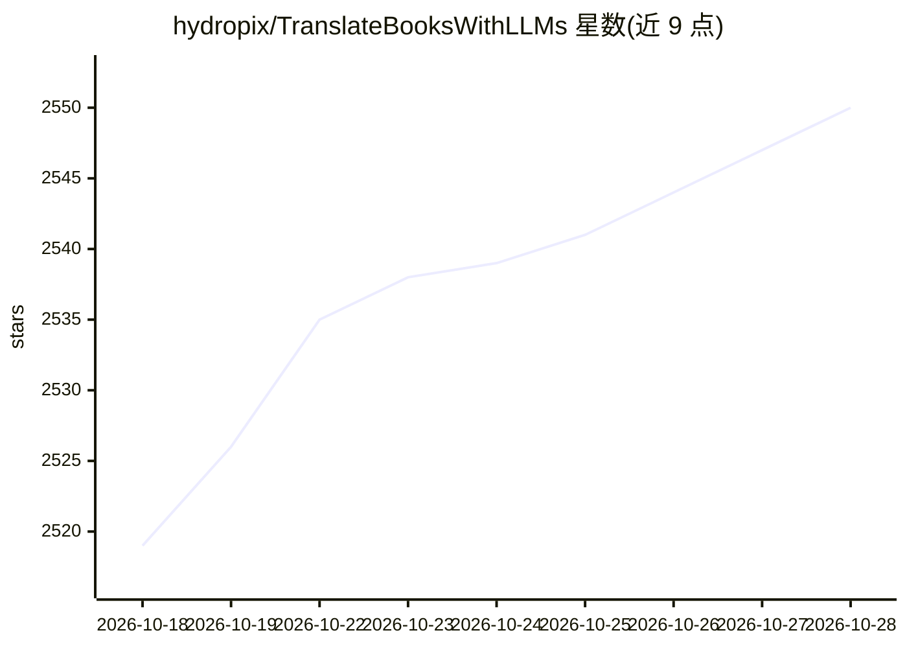

# hydropix/TranslateBooksWithLLMs

⭐ 2,550 · Python · AGPL-3.0 · 推送 2026-10-23 · [GitHub](https://github.com/hydropix/TranslateBooksWithLLMs) · [官网](https://github.com/hydropix/TranslateBooksWithLLMs/wiki) · 个人维护 · 中文 README

**用本地或云端 LLM 翻译整本书籍与文档的桌面/自托管应用**

TBL 是一个翻译长篇书籍、字幕与文档的桌面应用（也可从源码运行或 Docker 部署），支持 EPUB、SRT、DOCX、PDF、TXT 格式，保留原格式与结构（扫描 PDF 不支持、无 OCR）。通过智能分块处理无大小限制的文档，断点续译，支持从样书提取可复用文风预设与自动术语表。翻译后端可选 Ollama 本地运行或 DeepSeek、Gemini、Mistral、OpenAI、OpenRouter、Poe、NVIDIA NIM 及任意 OpenAI 兼容端点（llama.cpp、LM Studio、vLLM、LocalAI）。附带 Web UI（localhost:5000）与 CLI，多设备共享同一工作区，支持 API key 轮换与完成通知（L8-L17, L30-L60, L125-L144）。

## 筛选速览

| 维度 | 判定 | 备注 |
|---|---|---|
| AI 角色 | `ai-native` | 本体是模型或模型工具 |
| 许可风险 | `viral` | AGPL-3.0 |
| 部署形态 | `desktop` | 安装包/桌面程序 |
| 模型依赖 | local-ok | 支持本地模型 |
| 硬件要求 | — | 无带数字的原话,不猜 |
| 安装摩擦 | `low` | 无编译、无系统依赖或容器化 |
| 成熟度 | — | 结构信号不足 |

## 能力要点

- EPUB/SRT/DOCX/PDF/TXT 格式翻译且保留原格式与时间码
- 断点续译检查点系统，无文件大小限制
- 本地 Ollama 或多家云端 provider 及 OpenAI 兼容端点
- 自动术语表（NER 提取）与可复用文风预设

## 适用场景

- 把整本外文电子书翻译成目标语言并保留排版
- 用本地 Ollama 模型离线翻译敏感文档
- 翻译字幕文件且保持时间码同步

## 场景标签

`AI 写作` · 领域:内容生成

## 证据(README 行号)

> L8: A desktop app that translates **books**, **subtitles**, and **documents** with AI - local or cloud. Drop a file, pic
> L106: |`--provider`|ollama/openrouter/openai/gemini/mistral/deepseek/poe/nim|ollama|

## 星数曲线

2026-10-18 2,519 → 2026-10-28 2,550（+31）

---
*卡片 v1 · prompt 1.4 · 生成 2026-10-21 · 置信度 high · 依据 README sha `9c6ec8843c5c` · [字段定义](../../DATASET.md)*
