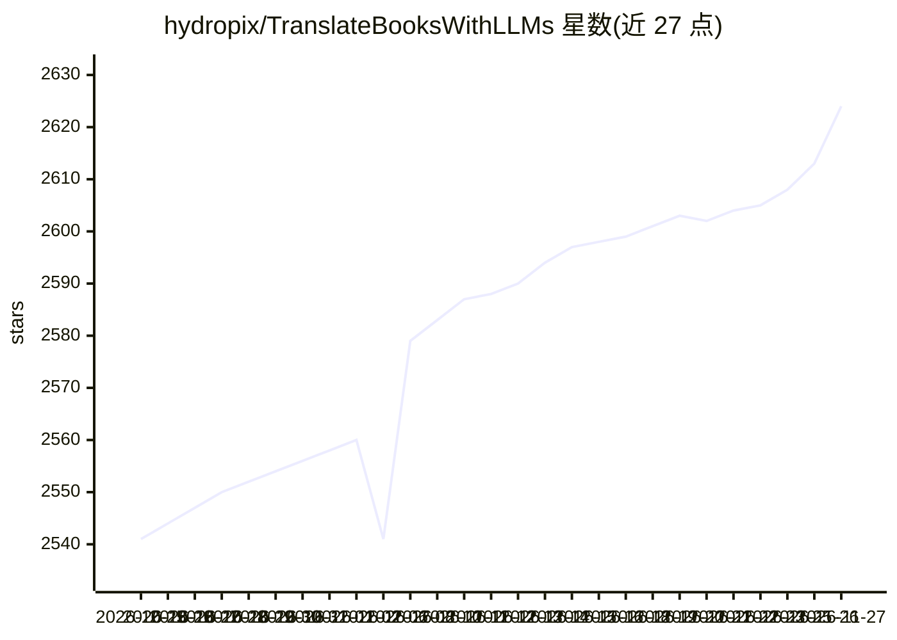

# hydropix/TranslateBooksWithLLMs

⭐ 2,624 · Python · AGPL-3.0 · 推送 2026-11-26 · [GitHub](https://github.com/hydropix/TranslateBooksWithLLMs) · [官网](https://github.com/hydropix/TranslateBooksWithLLMs/wiki) · 个人维护 · 中文 README

**用本地或云端 LLM 翻译整本书籍与文档的工具**

桌面应用与命令行工具，用大语言模型翻译书籍、字幕和文档，支持 EPUB、SRT、DOCX、PDF、TXT、Markdown、PGN、FB2 等格式。通过分块系统处理不限长度的内容，保留原有格式、时间戳与标签结构，检查点机制支持中断后续译。可从样书提取写作风格预设并应用到整书翻译，支持自动生成术语表与风格。提供 Web 界面、CLI、Docker 部署三种方式，翻译完成后可通过 webhook 推送通知。

## 筛选速览

| 维度 | 判定 | 备注 |
|---|---|---|
| AI 角色 | `ai-native` | 本体是模型或模型工具 |
| 许可风险 | `viral` | AGPL-3.0 |
| 部署形态 | `desktop` | 安装包/桌面程序 |
| 模型依赖 | local-ok | 支持本地模型 |
| 硬件要求 | — | 无带数字的原话,不猜 |
| 安装摩擦 | `low` | 无编译、无系统依赖或容器化 |
| 成熟度 | — | 结构信号不足 |

## 能力要点

- 支持 EPUB/SRT/DOCX/PDF/TXT/Markdown/PGN/FB2 格式并保留格式与结构
- 分块处理无文件大小限制，检查点支持中断续译
- 支持本地 Ollama 与多家云端 API，多 API key 自动轮换
- 术语表强制一致翻译、风格预设提取与二次润色（--refine）

## 适用场景

- 把整本外文电子书翻译成中文并保留排版
- 翻译视频字幕（SRT）并保持时间轴同步
- 本地部署 Ollama 离线翻译不让内容离开本机
- 翻译已标注的棋谱（PGN）且保留着法与标签

## 场景标签

 · 领域:翻译/本地化工具

## 证据(README 行号)

> L8: A desktop app that translates **books**, **subtitles**, and **documents** with AI - local or cloud. Drop a file, pic
> L35: - **Free & local** - Install Ollama and pull a model (e.g. `ollama pull qwen3:14b`). Nothing leaves your machine.
> L109: |`--provider`|ollama/openrouter/openai/gemini/mistral/deepseek/poe/nim|ollama|

## 星数曲线

2026-10-25 2,541 → 2026-11-27 2,624（+83）

---
*卡片 v1 · prompt 1.4 · 生成 2026-11-26 · 置信度 high · 依据 README sha `aecdc6458619` · [字段定义](../../DATASET.md)*
