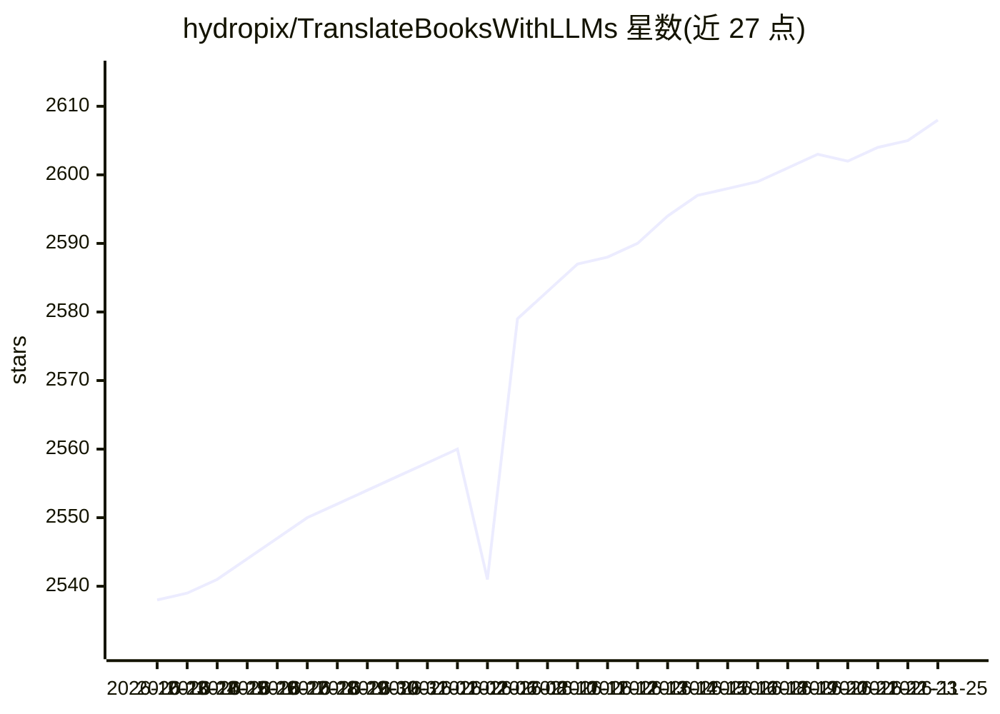

# hydropix/TranslateBooksWithLLMs

⭐ 2,608 · Python · AGPL-3.0 · 推送 2026-11-23 · [GitHub](https://github.com/hydropix/TranslateBooksWithLLMs) · [官网](https://github.com/hydropix/TranslateBooksWithLLMs/wiki) · 个人维护 · 中文 README

**用 LLM 翻译整本书籍与文档的桌面应用**

桌面应用与 CLI 工具：用本地或云端 LLM 翻译整本书籍、字幕与文档，支持 EPUB、SRT、DOCX、PDF、TXT、PGN 格式，保留原有格式、结构与时间轴。机制包括分块处理无长度限制、检查点断点续译、术语表与文风预设（可自动从原文抽取）、二轮润色与 TTS。安装包形式分发，也支持源码运行、CLI 与 Docker 部署；Web 界面在 localhost:5000，多设备可共享同一工作区。

## 筛选速览

| 维度 | 判定 | 备注 |
|---|---|---|
| AI 角色 | `ai-native` | 本体是模型或模型工具 |
| 许可风险 | `viral` | AGPL-3.0 |
| 部署形态 | `desktop` | 安装包/桌面程序 |
| 模型依赖 | local-ok | 支持本地模型 |
| 硬件要求 | — | 无带数字的原话,不猜 |
| 安装摩擦 | `low` | 无编译、无系统依赖或容器化 |
| 成熟度 | — | 结构信号不足 |

## 能力要点

- 支持 EPUB/SRT/DOCX/PDF/TXT/PGN 格式并保留格式与时间轴
- 无文件大小限制，智能分块并保持上下文，支持断点续译
- 接入 8 种翻译 provider，含本地 Ollama 与 OpenAI 兼容端点（llama.cpp/LM Studio/vLLM/LocalAI）
- 多 API key 轮换应对限流，完成后可经 ntfy/Discord/Slack 等 webhook 通知

## 适用场景

- 把整本 EPUB/PDF 书籍翻译成目标语言并保留排版
- 翻译 SRT 字幕并保持时间轴同步
- 用本地 Ollama 模型离线翻译且数据不出本机
- 翻译带注释的国际象棋 PGN 棋谱

## 场景标签

`AI 写作` · 领域:内容生成

## 证据(README 行号)

> L8: A desktop app that translates **books**, **subtitles**, and **documents** with AI - local or cloud. Drop a file, pic
> L33: - **Free & local** - Install Ollama and pull a model (e.g. `ollama pull qwen3:14b`). Nothing leaves your machine.
> L107: |`--provider`|ollama/openrouter/openai/gemini/mistral/deepseek/poe/nim|ollama|

## 星数曲线

2026-10-23 2,538 → 2026-11-25 2,608（+70）

---
*卡片 v1 · prompt 1.4 · 生成 2026-11-24 · 置信度 high · 依据 README sha `4aee5d292ce2` · [字段定义](../../DATASET.md)*
