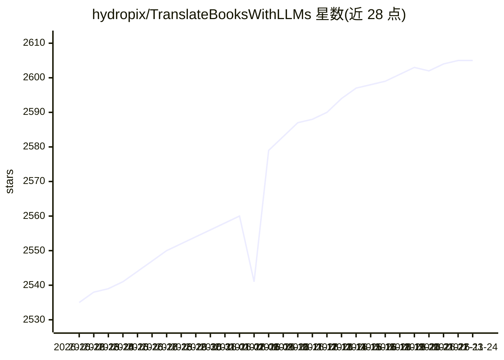

# hydropix/TranslateBooksWithLLMs

⭐ 2,605 · Python · AGPL-3.0 · 推送 2026-11-21 · [GitHub](https://github.com/hydropix/TranslateBooksWithLLMs) · [官网](https://github.com/hydropix/TranslateBooksWithLLMs/wiki) · 个人维护

**用 LLM 翻译整本书籍与文档的桌面应用，保留格式**

桌面/本地 Web 应用，调用 LLM 翻译整本电子书、字幕与文档，支持 EPUB、SRT、DOCX、PDF、TXT、PGN 格式。核心机制：分块处理不限文件大小，保留 EPUB 格式、SRT 时间码与标签，断点续译，可提取复用写作风格预设，自动从文档派生术语表与风格。翻译提供方可选本地 Ollama 或多家云 API；提供 Web UI、CLI 与 Docker 部署。限制：扫描版 PDF 不支持（无 OCR），PDF 与 PGN 暂不可用二次润色。

## 筛选速览

| 维度 | 判定 | 备注 |
|---|---|---|
| AI 角色 | `ai-native` | 本体是模型或模型工具 |
| 许可风险 | `viral` | AGPL-3.0 |
| 部署形态 | `desktop` | 安装包/桌面程序 |
| 模型依赖 | local-ok | 支持本地模型 |
| 硬件要求 | — | 无带数字的原话,不猜 |
| 安装摩擦 | `low` | 无编译、无系统依赖或容器化 |
| 成熟度 | — | 结构信号不足 |

## 能力要点

- 支持 EPUB/SRT/DOCX/PDF/TXT/PGN 格式翻译并保留格式与时间码
- 分块处理无文件大小限制，检查点机制支持中断后续译
- 多翻译提供方：Ollama 本地运行及 DeepSeek、Gemini、OpenAI 等云 API
- 自动术语表与写作风格预设，支持 API key 轮换与并行翻译

## 适用场景

- 翻译整本 EPUB 电子书并保留原有排版结构
- 用本地 Ollama 模型离线翻译文档，内容不出本机
- 批量翻译字幕文件并保持时间码同步
- 长篇翻译任务中断后从断点继续

## 场景标签

 · 领域:翻译/文档工具

## 证据(README 行号)

> L8: A desktop app that translates **books**, **subtitles**, and **documents** with AI - local or cloud. Drop a file, pic
> L31: That's it (就这么简单 · これだけ · 이게 다예요). On first launch, you choose a translation provider:
> L107: |`--provider`|ollama/openrouter/openai/gemini/mistral/deepseek/poe/nim|ollama|

## 星数曲线

2026-10-22 2,535 → 2026-11-24 2,605（+70）

---
*卡片 v1 · prompt 1.4 · 生成 2026-11-23 · 置信度 high · 依据 README sha `4ecb9a21cc86` · [字段定义](../../DATASET.md)*
