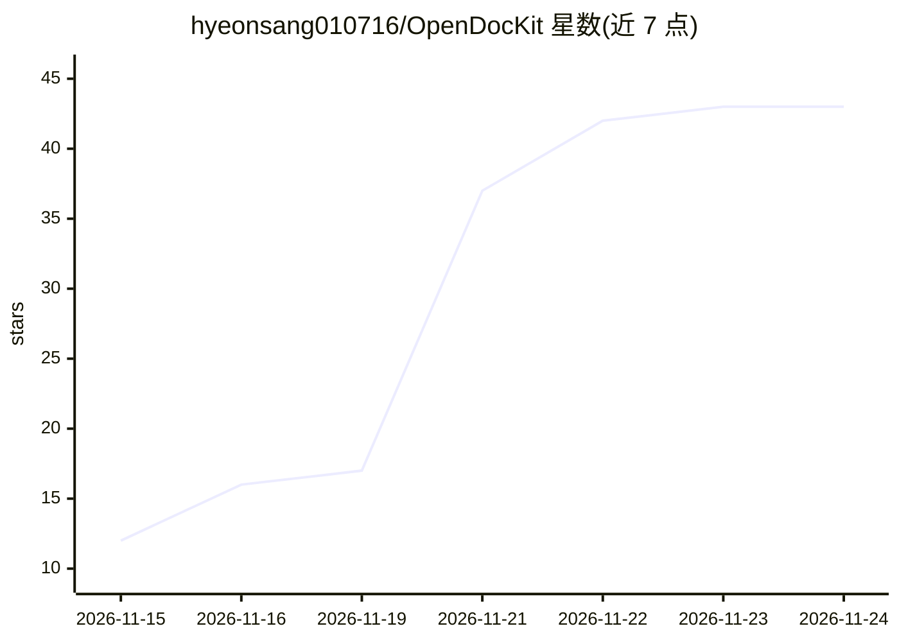

# hyeonsang010716/OpenDocKit

⭐ 47 · Python · MIT · 推送 2026-11-24 · [GitHub](https://github.com/hyeonsang010716/OpenDocKit) · [官网](https://pypi.org/project/opendockit/) · 个人维护

**把多格式文档转为 LLM 可用 Markdown 的转换库**

Python 库，将 PDF、Office、HWP/HWPX、ODF、RTF、EPUB、HTML、邮件与图片转为 Markdown，保留合并单元格、多栏阅读顺序、无框表格、脚注、公式转 LaTeX 等结构。内置从零实现的 HWP 5.x 解析器与 CP949 检测；按内容而非扩展名识别文件；对不可信上传做 zip bomb 等资源限制，IsolatedConverter 在独立 worker 进程中运行并设内存与时间限额。无 ML 模型、无需 GPU，扫描件与图片需接入视觉模型（可选 OpenAI describer）才能描述。提供 CLI、MCP server 及 LangChain/LlamaIndex/Dify/Open WebUI/Hermes/Claude Code 集成。限制：需 Python 3.12+，Windows 尚不支持 HTML/邮件/EPUB；旧 .doc/.ppt 需另装 LibreOffice。

## 筛选速览

| 维度 | 判定 | 备注 |
|---|---|---|
| AI 角色 | `ai-ecosystem` | LLM/agent 周边工具 |
| 许可风险 | `permissive` | MIT |
| 部署形态 | `self-host` | docker 或自建部署 |
| 模型依赖 | — | README 未给出锁定关系 |
| 硬件要求 | — | 无带数字的原话,不猜 |
| 安装摩擦 | `low` | 无编译、无系统依赖或容器化 |
| 成熟度 | — | 结构信号不足 |

## 能力要点

- 支持 26 种以上格式含 HWP/HWPX，保留合并单元格、无框表格、脚注、图表转数据表等结构
- 按内容检测文件类型，扩展名错误时给出警告
- IsolatedConverter 独立 worker 进程 + 内存/时间/字符数预算，处理不可信上传
- 无 ML 模型、无 GPU，pip 安装即用；提供 MCP server 与多平台集成

## 适用场景

- RAG 管线中把用户上传的 PDF/Office/韩文文档转为 Markdown 再切分索引
- 为 Claude/Cursor 等 agent 提供读取本地多格式文档的 MCP 服务
- 文件上传服务安全转换不可信文档并限制资源消耗
- 配合 Open WebUI/Dify 做每页一份文档的外部内容抽取

## 场景标签

`文档解析` · 领域:知识与检索

## 证据(README 行号)

> L113: from opendockit.integrations.langchain import OpenDocKitLoader
> L121: opendockit-mcp --root ~/Documents     # MCP server: Claude, Cursor and other agents read your documents as Markdow
> L243: |Integrations|LangChain, LlamaIndex, the MCP server, Hermes Agent, Claude Code, Dify and Open WebUI|

## 星数曲线

2026-11-15 12 → 2026-11-24 43（+31）

---
*卡片 v1 · prompt 1.4 · 生成 2026-11-18 · 置信度 mid · 依据 README sha `4706a9c8b9b5` · [字段定义](../../DATASET.md)*
