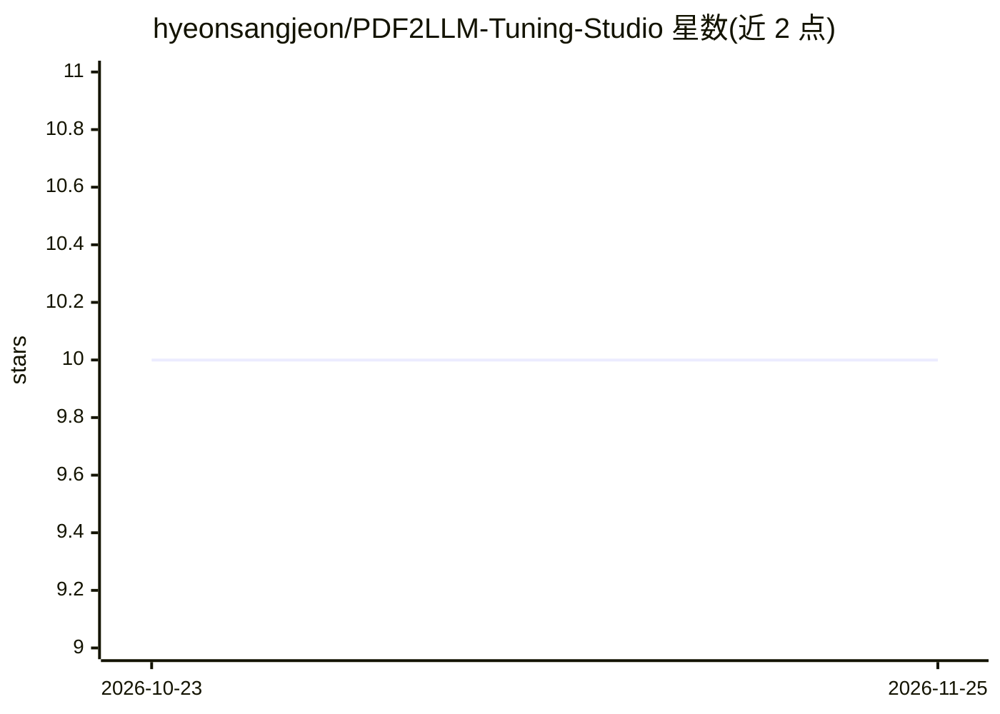

# hyeonsangjeon/PDF2LLM-Tuning-Studio

⭐ 10 · Python · NOASSERTION · 推送 2026-08-06 · [GitHub](https://github.com/hyeonsangjeon/PDF2LLM-Tuning-Studio) · 个人维护

**PDF 文档自动生成 QA 数据集并微调 LLM 的端到端流水线**

从 PDF 提取文本/表格/图像（Unstructured 库，CPU 轻量容器，GPU 加速可选），经多个 LLM 后端生成带出处校验的 QA 对，含语言锁定、去重/质量过滤、多角色提示与图表上下文关联；再经预处理与 LoRA（Unsloth）微调开源模型。提供单行 Python API、Docker Compose 一键运行与本地 Web 演示；默认后端为 Azure AI Foundry/Azure ML，同时支持 AWS Bedrock+SageMaker 与本地 Ollama；两个可复现实验轨道（量化服务对比、PDF 原生后训练工作流），数值经 CI 证据索引核验。

## 筛选速览

| 维度 | 判定 | 备注 |
|---|---|---|
| AI 角色 | `ai-native` | 本体是模型或模型工具 |
| 许可风险 | `none` | NOASSERTION |
| 部署形态 | `self-host` | docker 或自建部署 |
| 模型依赖 | local-ok | 支持本地模型 |
| 硬件要求 | `gpu-8g` | |
| 安装摩擦 | `low` | 无编译、无系统依赖或容器化 |
| 成熟度 | `idea` | |

## 能力要点

- QA 生成多后端切换：Azure/OpenAI/Bedrock/Ollama 由一个环境变量切换，Ollama 无需凭据
- 数据质量机制：空项/拒答/重复问题过滤与语言漂移锁定（OUTPUT_LANGUAGE）
- 图表上下文管线：坐标、阅读顺序、页/节/图索引出处随 QA 记录
- Unsloth+LoRA 微调，最低 8GB VRAM；量化对比轨道（BF16/INT4 PTQ/QAT）附 vLLM 基准数据

## 适用场景

- 把领域 PDF 批量转成可追溯出处的微调数据集
- 在没有云端凭据时用本地 Ollama 生成与预览 QA 数据
- 在 8-16GB 显卡上用 LoRA 微调开源模型
- 复现 KorQuAD 量化（PTQ/QAT）与 vLLM 服务基准实验

## 场景标签

`文档解析` `微调` `模型量化` · 领域:知识与检索

## 证据(README 行号)

> L3: PDF 문서에서 지식을 추출하고 대규모 언어 모델(LLM)을 효율적으로 파인튜닝하는 **Azure-first 멀티클라우드** 엔드투엔드 파이프라인입니다. 경량 CPU 컨테이너의 PDF 파싱과 최적화된 LLM 
> L63: - **Q&A 자동 생성 (멀티 공급자)**: Azure AI Foundry(Azure OpenAI · Foundry Agent), OpenAI, Amazon Bedrock Claude, **로컬 Ollam
> L200: Unsloth와 LoRA 어댑터로 메모리 효율적 파인튜닝을 수행합니다. `fine_tuning/03_train_unsloth_model.ipynb`에서 진행하며, Azure ML Compute 또는 AWS

## 星数曲线

2026-10-23 10 → 2026-11-25 10（+0）

---
*卡片 v1 · prompt 1.4 · 生成 2026-11-20 · 置信度 high · 依据 README sha `3b4a5d1de3fc` · [字段定义](../../DATASET.md)*
