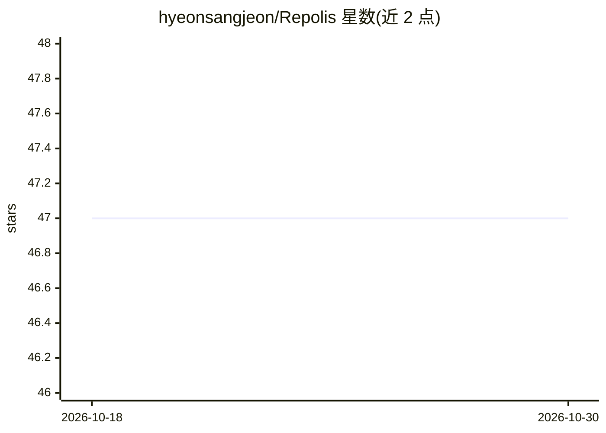

# hyeonsangjeon/Repolis

⭐ 47 · JavaScript · MIT · 推送 2026-10-28 · [GitHub](https://github.com/hyeonsangjeon/Repolis) · [官网](https://hyeonsangjeon.github.io/Repolis/) · 个人维护

**把公开 GitHub 仓库变成可步行的 3D 城镇的可视化作品**

基于 Three.js 的静态站点：读取公开 GitHub 元数据与累计流量，将仓库映射为可步行的 3D 城镇中的建筑——访客决定楼高、fork 决定地块宽度、clone 决定旗帜与金边、star 决定屋顶装饰等，仓库按主题分区。提供自然语言搜索的 Gitber 出租车导航、城镇生长回放、贡献议题导引（Open Source Quests）、档案地下室（Undercroft）等功能。用户输入 GitHub 用户名即可生成城镇，也可复制模板部署到 GitHub Pages，数据每日经 GitHub Actions 刷新；fork 部署不调用上游 AI 或实时 Workers。仅使用公开元数据，无需登录或 token。

## 筛选速览

| 维度 | 判定 | 备注 |
|---|---|---|
| AI 角色 | `ai-enhanced` | 去掉 AI 部分产品仍成立 |
| 许可风险 | `permissive` | MIT |
| 部署形态 | `None` |  |
| 模型依赖 | — | README 未给出锁定关系 |
| 硬件要求 | — | 无带数字的原话,不猜 |
| 安装摩擦 | `low` | 无编译、无系统依赖或容器化 |
| 成熟度 | — | 结构信号不足 |

## 能力要点

- 流量/star/fork 等指标映射为 3D 建筑形态，仓库按主题分区
- 输入 GitHub 用户名或 owner/repo 即可生成城镇，无需 token 或注册
- 提供模板复制到 GitHub Pages + Actions 每日刷新，零构建（Three.js 静态站）
- Open Source Quests 按请求匿名检索 good first issue 并导引至对应仓库建筑

## 适用场景

- 把自己的开源仓库做成可分享的 3D 作品集/门户
- 以探索式交互代替列表向他人介绍仓库与贡献机会
- 回顾仓库创建时间线，生成城镇生长回放

## 场景标签

 · 领域:数据可视化/开发者工具

## 证据(README 行号)

> L32: |Gitber searches in natural language, then drives to the result|repository discovery becomes an interaction rather 
> L59: Forks automatically infer `<owner>.github.io` as the town owner and do **not** call the upstream AI or realtime Wor

## 星数曲线

2026-10-18 47 → 2026-10-30 47（+0）

---
*卡片 v1 · prompt 1.4 · 生成 2026-10-25 · 置信度 mid · 依据 README sha `c8e4128342c5` · [字段定义](../../DATASET.md)*
