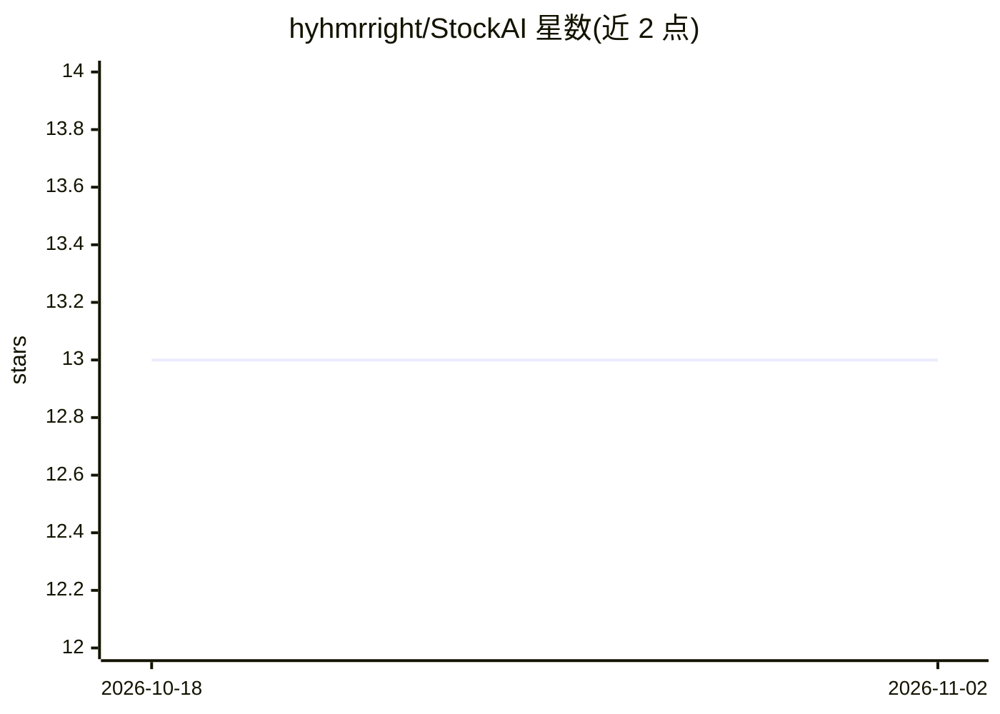

# hyhmrright/StockAI

⭐ 13 · TypeScript · MIT · 推送 2026-10-31 · [GitHub](https://github.com/hyhmrright/StockAI) · [官网](https://github.com/hyhmrright/StockAI/releases/latest) · 个人维护 · 中文 README

**本地运行的 AI 股票研究桌面应用，覆盖美股与 A 股**

基于 Tauri 2 的单文件桌面应用（UI → Rust 核心 → Bun Sidecar 三层），聚合美股与 A 股的实时新闻、行情、基本面与资金流，提供 LLM 情绪扫描、13 位投资大师 agent 分歧与共识评级、带引用的财报问答，以及量化评分、自然语言选股、策略回测、持仓跟踪与价格提醒。模型自选：OpenAI、Anthropic、DeepSeek、GLM 或本地 Ollama，API key 存于系统级存储。Releases 提供预编译安装包，也可用 Bun + Rust 从源码构建；输出声明不构成投资建议。

## 筛选速览

| 维度 | 判定 | 备注 |
|---|---|---|
| AI 角色 | `ai-native` | 本体是模型或模型工具 |
| 许可风险 | `permissive` | MIT |
| 部署形态 | `desktop` | 安装包/桌面程序 |
| 模型依赖 | local-ok | 支持本地模型 |
| 硬件要求 | — | 无带数字的原话,不猜 |
| 安装摩擦 | `low` | 无编译、无系统依赖或容器化 |
| 成熟度 | — | 结构信号不足 |

## 能力要点

- 13 位投资大师 agent 各按其框架独立分析并合成共识评级
- 聊天问答基于财报/新闻/量化指标，答案附可点击引用
- 自然语言选股（如 ROE>15% 且 P/E<20 的主板 A 股）与策略回测
- 多数据源冗余（腾讯/东方财富/新浪/Yahoo），API key 存系统级存储

## 适用场景

- 在本地对持仓的美股与 A 股做 AI 情绪与多大师观点分析
- 用自然语言描述条件筛选全市场并查看解读结果
- 跑策略回测并跟踪各位大师历史命中等业绩曲线

## 场景标签

`金融量化` `文档问答` · 领域:知识与检索

## 证据(README 行号)

> L13: **An AI equity research desk that runs on your own machine.** StockAI gathers live news, prices, fundamentals and m
> L15: > **Bring your own model.** OpenAI, Anthropic, DeepSeek, GLM, or a fully local Ollama. This project hosts nothing a
> L22: - **Deep Master Analysis** — 13 investor-master agents (Buffett, Munger, Graham, Burry, Wood, Lynch, Fisher, Ackman

## 星数曲线

2026-10-18 13 → 2026-11-02 13（+0）

---
*卡片 v1 · prompt 1.4 · 生成 2026-10-31 · 置信度 high · 依据 README sha `480d07e0e996` · [字段定义](../../DATASET.md)*
