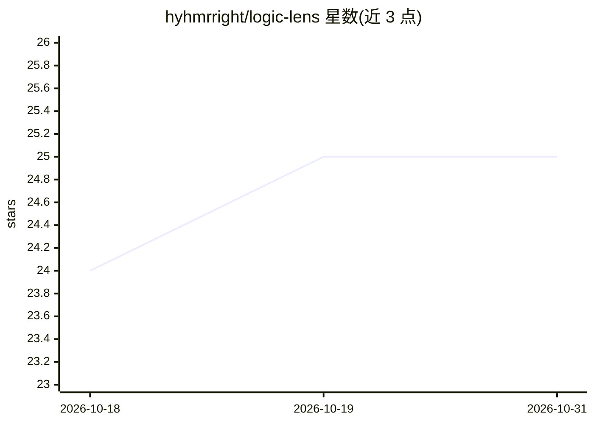

# hyhmrright/logic-lens

⭐ 25 · Python · MIT · 推送 2026-10-30 · [GitHub](https://github.com/hyhmrright/logic-lens) · [官网](https://github.com/hyhmrright/logic-lens) · 个人维护

**面向 Claude Code/Codex/Gemini CLI 的半形式化执行追踪代码审查技能包**

以六个技能（logic-review/explain/diff/locate/health/fix-all）形式分发的 AI 代码审查工具，要求宿主模型在给出结论前构造显式执行追踪，每条发现附带 Premises → Trace → Divergence → Trigger → Remedy 链。覆盖九类逻辑风险（影子覆盖、类型契约、边界、并发/异步、资源生命周期等），并提供含 104 个案例、由规则脚本离线评分的基准。支持 Claude Code 插件市场、Gemini CLI 扩展与 Codex CLI 技能安装器三种接入途径，效果依赖宿主模型是否实际调用技能（文档记录 Haiku 在 claude -p 模式下 38.7% 的情况为未加载技能）。

## 筛选速览

| 维度 | 判定 | 备注 |
|---|---|---|
| AI 角色 | `ai-ecosystem` | LLM/agent 周边工具 |
| 许可风险 | `permissive` | MIT |
| 部署形态 | `None` |  |
| 模型依赖 | locked-api |  |
| 硬件要求 | — | 无带数字的原话,不猜 |
| 安装摩擦 | `low` | 无编译、无系统依赖或容器化 |
| 成熟度 | — | 结构信号不足 |

## 能力要点

- 九类逻辑风险维度的审查（L1–L9）
- 每条发现附带 Premises → Trace → Divergence → Trigger → Remedy 审计链
- 104 个评测案例，由规则脚本 grade-iteration.py 离线评分而非 LLM 评审
- logic-fix-all 自主审查-修复管线（需同意后执行并逐项验证）

## 适用场景

- 在 Claude Code/Codex/Gemini CLI 中审查 linter 与类型检查器无法发现的行为性缺陷
- 定位失败测试或崩溃的根因并获取逐步执行解释
- 对整个代码库生成聚合逻辑健康度面板
- 验证代码两个版本是否行为等价

## 场景标签

`代码审查` · 领域:编码与开发

## 证据(README 行号)

> L108: Logic-Lens ships six skills: **logic-review** (find behavioral bugs via execution tracing), **logic-explain** (tra
> L17:  Claude Code Plugin
> L104: For Gemini CLI and Codex CLI, see Installation below.

## 星数曲线

2026-10-18 24 → 2026-10-31 25（+1）

---
*卡片 v1 · prompt 1.4 · 生成 2026-10-27 · 置信度 high · 依据 README sha `75ba69cbf05a` · [字段定义](../../DATASET.md)*
