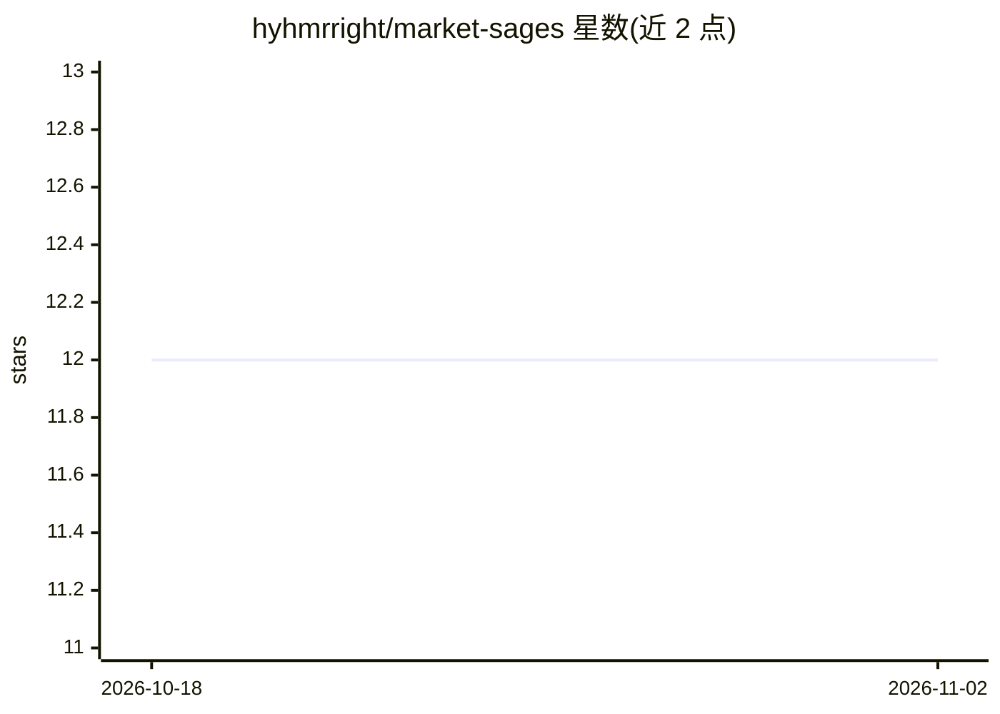

# hyhmrright/market-sages

⭐ 12 · Python · MIT · 推送 2026-04-18 · [GitHub](https://github.com/hyhmrright/market-sages) · [官网](https://github.com/hyhmrright/market-sages/blob/main/README.md) · 个人维护 · 中文 README

**13 位传奇投资人格式的股票分析提示词技能，供 CLI 工具调用**

一个以 skill.md 为核心的提示词技能包：定义 Buffett、Munger、Taleb 等 13 位投资者人格的分析框架，用户在 CLI agent 中输入 /sages <代码> 即得到多人格股票分析，支持价值/成长/风险分组、多股对比与指定人格。通过 Claude Code 插件市场、Codex CLI 技能安装器、Gemini CLI 扩展安装，也可复制为任意 LLM 界面的系统提示词。无需 API key 与 Python 环境，数据来自宿主的 web 搜索；声明仅供教育娱乐，非投资建议。

## 筛选速览

| 维度 | 判定 | 备注 |
|---|---|---|
| AI 角色 | `ai-ecosystem` | LLM/agent 周边工具 |
| 许可风险 | `permissive` | MIT |
| 部署形态 | `None` |  |
| 模型依赖 | — | README 未给出锁定关系 |
| 硬件要求 | — | 无带数字的原话,不猜 |
| 安装摩擦 | `low` | 无编译、无系统依赖或容器化 |
| 成熟度 | — | 结构信号不足 |

## 能力要点

- 13 位投资者人格框架，可按价值/成长/风险分组或 @ 指定调用
- 提供 Claude Code / Codex CLI / Gemini CLI 三种安装通道
- skill.md 可复制为任意 LLM 界面的系统提示词
- 带结构校验与提示词评测脚本（评测需 ANTHROPIC_API_KEY）

## 适用场景

- 让 CLI agent 按多位投资者视角分析某只股票
- 比较多只股票或复盘自己的持仓组合
- 在 ChatGPT/Claude.ai 等界面以系统提示词方式使用同一框架

## 场景标签

`提示工程` `金融量化` · 领域:Agent 开发

## 证据(README 行号)

> L10: **Market Sages** summons a council of the world's greatest investors to analyze any stock — Warren Buffett, Charlie
> L54: /plugin marketplace add hyhmrright/market-sages
> L61:   -o ~/.claude/skills/market-sages.md
> L147: Copy the contents of `skill.md` as your **system prompt** in any LLM interface — ChatGPT, Claude.ai, Gemini, Perpl

## 星数曲线

2026-10-18 12 → 2026-11-02 12（+0）

---
*卡片 v1 · prompt 1.4 · 生成 2026-11-01 · 置信度 high · 依据 README sha `8df43b3f4358` · [字段定义](../../DATASET.md)*
