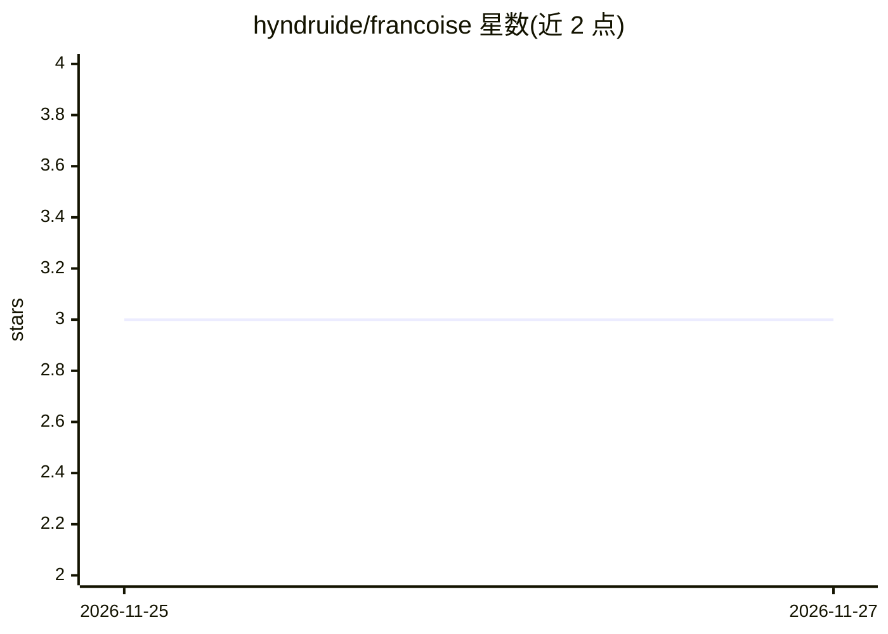

# hyndruide/francoise

⭐ 3 · Python · 推送 2026-11-23 · [GitHub](https://github.com/hyndruide/francoise) · 个人维护

**Home Assistant 语音/聊天助手的 Add-on：多引擎 AI 管家**

面向 Home Assistant 的 Docker Add-on，内置多个 AI Agent 引擎（Google Antigravity agy、OpenAI Codex CLI、Groq、OpenRouter、Ollama），通过原生 MCP 服务器（ha-mcp）与 Device Auth 登录复用用户个人订阅账号，实现按实体搜索、控制家居，以及实时生成/修改 Lovelace 卡片与仪表盘；可作为 Assist 对话引擎接入语音助手，并支持在自动化中调用。安装方式为 Home Assistant Add-on 商店添加仓库后安装，另有 HACS 集成（可选）配置主机、端口与 API 令牌。

## 筛选速览

| 维度 | 判定 | 备注 |
|---|---|---|
| AI 角色 | `ai-ecosystem` | LLM/agent 周边工具 |
| 许可风险 | `none` | — |
| 部署形态 | `None` |  |
| 模型依赖 | local-ok | 支持本地模型 |
| 硬件要求 | — | 无带数字的原话,不猜 |
| 安装摩擦 | `low` | 无编译、无系统依赖或容器化 |
| 成熟度 | — | 结构信号不足 |

## 能力要点

- 内置 Antigravity (agy)、Codex CLI、Groq、OpenRouter、Ollama 多引擎可选
- MCP 服务器 (ha-mcp) 操作 Home Assistant 实体与 Lovelace 卡片
- Device Auth 复用个人 Google/ChatGPT 订阅，无需按 token 付费
- 可作为 Assist 对话引擎，支持自动化中调用

## 适用场景

- 在 Home Assistant 中用对话搜索实体并控制家居设备
- 让 AI 直接生成或修改 Lovelace 仪表盘卡片
- 接入 Assist 实现全屋语音问答
- 在自动化脚本中让 AI 检查门窗状态并生成摘要

## 场景标签

`聊天机器人` `语音 Agent` · 领域:对话与助手

## 证据(README 行号)

> L7: **Françoise** est un module complémentaire tout-en-un pour **Home Assistant** qui embarque des agents IA autonomes d
> L9: Grâce à son serveur **MCP natif (`ha-mcp`)** et à la connexion **Device Auth**, vous pouvez utiliser vos abonnements

## 星数曲线

2026-11-25 3 → 2026-11-27 3（+0）

---
*卡片 v1 · prompt 1.4 · 生成 2026-11-24 · 置信度 high · 依据 README sha `65786450ee2b` · [字段定义](../../DATASET.md)*
