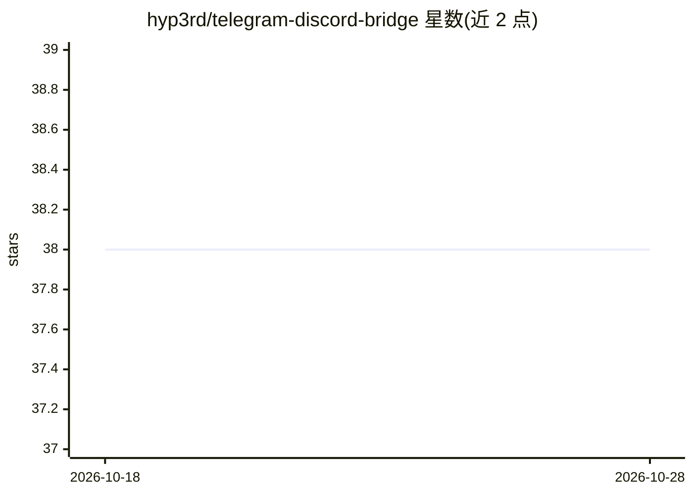

# hyp3rd/telegram-discord-bridge

⭐ 38 · Python · MIT · 推送 2026-10-20 · [GitHub](https://github.com/hyp3rd/telegram-discord-bridge) · 个人维护

**把 Telegram 频道消息转发到 Discord 的桥接机器人，可选 AI 增强**

用 Python 编写的桥接服务：监听 Telegram 频道并把消息、媒体与 URL 预览转发到指定 Discord 频道，支持按 hashtag 过滤、提及角色/用户、维护消息映射以支持回复、掉线重连与补发、状态持久化、反垃圾与管理 API（FastAPI，含 Telegram MFA 登录）。消息历史默认存本地 JSON，可切换 SQLite。可选启用 OpenAI API 生成转发文本的建议与情感分析、由 AI 模型标记可疑消息。安装通过 git clone 源码 + pip 依赖，或使用预构建 Docker 镜像。由个人开发者在业余时间维护，声明与 Telegram/Discord 无关联。

## 筛选速览

| 维度 | 判定 | 备注 |
|---|---|---|
| AI 角色 | `ai-enhanced` | 去掉 AI 部分产品仍成立 |
| 许可风险 | `permissive` | MIT |
| 部署形态 | `self-host` | docker 或自建部署 |
| 模型依赖 | — | README 未给出锁定关系 |
| 硬件要求 | — | 无带数字的原话,不猜 |
| 安装摩擦 | `low` | 无编译、无系统依赖或容器化 |
| 成熟度 | — | 结构信号不足 |

## 能力要点

- Telegram 频道→Discord 的消息/媒体转发，支持 hashtag 过滤与提及设置
- 维护消息映射支持跨平台回复，掉线自动重连并补发漏掉的消息
- 可选 OpenAI API 生成建议与情感分析、AI 标记可疑消息
- 提供 FastAPI 管理 API（端口 8000）与 Docker 预构建镜像

## 适用场景

- 把关注的 Telegram 频道内容同步到自己的 Discord 服务器
- 按 hashtag 白名单只转发特定主题的消息并提醒成员
- 远程管理桥接进程，包括 Telegram MFA 登录

## 场景标签

 · 领域:消息桥接/聊天机器人

## 证据(README 行号)

> L6: A `Python` bridge to forward messages from any Telegram **channel** to your **Discord** server, because why not? It 
> L17: - **It supports OpenAI's API to generate suggestions and sentiment analyses based on the text you're forwarding.**

## 星数曲线

2026-10-18 38 → 2026-10-28 38（+0）

---
*卡片 v1 · prompt 1.4 · 生成 2026-10-25 · 置信度 mid · 依据 README sha `2da6fa8405f1` · [字段定义](../../DATASET.md)*
