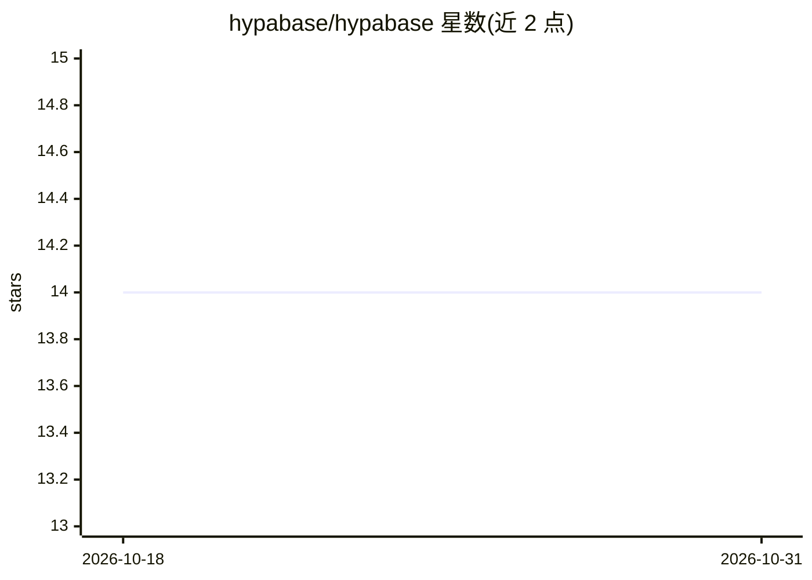

# hypabase/hypabase

⭐ 14 · Python · Apache-2.0 · 推送 2026-04-10 · [GitHub](https://github.com/hypabase/hypabase) · [官网](https://docs.hypabase.app) · 个人维护

**带溯源与 SQLite 持久化的 Python 超图库**

Python 超图（hypergraph）库：一条超边可连接 2+ 节点，每条边携带 source 与 confidence 溯源字段，数据自动持久化到本地 SQLite 文件。提供 O(1) 节点集查找、命名空间隔离、按来源/置信度过滤查询、CLI 命令行，以及内置 Memory MCP 服务器（7 个工具）供 AI agent 用作跨会话持久记忆，兼容 Claude Code、Cursor、Windsurf 等 MCP 客户端。以 uv/pip 安装，Apache 2.0 许可。

## 筛选速览

| 维度 | 判定 | 备注 |
|---|---|---|
| AI 角色 | `ai-ecosystem` | LLM/agent 周边工具 |
| 许可风险 | `permissive` | Apache-2.0 |
| 部署形态 | `library` | 以包/库形式分发 |
| 模型依赖 | — | README 未给出锁定关系 |
| 硬件要求 | — | 无带数字的原话,不猜 |
| 安装摩擦 | `low` | 无编译、无系统依赖或容器化 |
| 成熟度 | — | 结构信号不足 |

## 能力要点

- 超边连接 2+ 节点，每条边携带 source/confidence 溯源字段
- SQLite 单文件持久化与命名空间隔离
- Memory MCP 服务器提供 7 个 agent 记忆工具
- CLI：init/node/edge/query/stats

## 适用场景

- 为 AI agent 提供结构化、可查询的跨会话持久记忆
- 存储带来源与置信度的知识图谱/关系数据
- RAG 流程中存放抽取出的多元关系

## 场景标签

`Agent 记忆` `知识图谱` `RAG` · 领域:Agent 开发

## 证据(README 行号)

> L34: - **Memory MCP server** — 7 tools for AI agent persistent memory (remember, recall, forget, consolidate, connection
> L87: Hypabase includes a Memory MCP server with 7 tools so AI agents can use it as structured, persistent memory. Works 

## 星数曲线

2026-10-18 14 → 2026-10-31 14（+0）

---
*卡片 v1 · prompt 1.4 · 生成 2026-10-31 · 置信度 high · 依据 README sha `3f2fb520c67b` · [字段定义](../../DATASET.md)*
