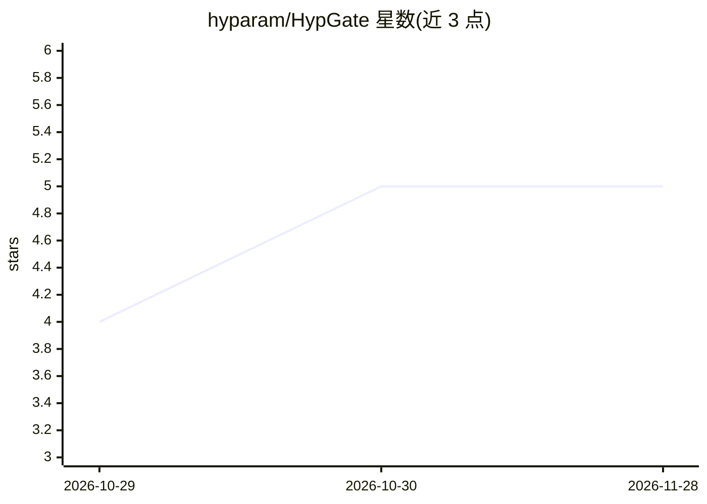

# hyparam/HypGate

⭐ 5 · Rust · MIT · 推送 2026-11-10 · [GitHub](https://github.com/hyparam/HypGate) · [官网](https://hypaware.ai) · 组织维护

**形式化验证的 LLM 网关：转发请求并写审计日志**

小型 LLM 网关，核心决策逻辑用 Verus 机器验证。将请求体原样转发给所配置的 provider，流式返回响应，并把每次交互写入磁盘审计日志，可选发送至 HypAware 或 S3。提供三项保证：数据只发往配置目的地、逐字节忠实转发与审计记录（含 strict 模式）、核心无 panic/越界与崩溃后日志恢复。不做 API 翻译、不加载插件。通过 rustup 安装 Rust 后源码编译运行，远程访问需 TLS 反向代理。

## 筛选速览

| 维度 | 判定 | 备注 |
|---|---|---|
| AI 角色 | `ai-ecosystem` | LLM/agent 周边工具 |
| 许可风险 | `permissive` | MIT |
| 部署形态 | `None` |  |
| 模型依赖 | — | README 未给出锁定关系 |
| 硬件要求 | — | 无带数字的原话,不猜 |
| 安装摩擦 | `medium` | 含编译或系统依赖之一 |
| 成熟度 | — | 结构信号不足 |

## 能力要点

- 决策核心经 Verus 机器验证（PROOFS.md 列出契约与假设）
- 逐字节忠实转发与审计日志，strict 模式下未记录则请求失败
- 崩溃后恢复完整日志记录，日志按 128 MiB/24 小时轮转且不删除
- 日志可发送至 HypAware 或 S3，发送失败不影响服务

## 适用场景

- 需要每条 LLM 请求/响应留有可审计记录的环境
- 以固定凭证将客户端请求转发至指定 provider
- 部署时要求网关核心经形式化验证

## 场景标签

`模型网关` · 领域:Agent 开发

## 证据(README 行号)

> L10: HypGate is a small LLM gateway with a machine-checked core. It forwards request
> L19: The gateway's decision-making core is proved correct with
> L83: cargo build --release --locked --bin hypgate

## 星数曲线

2026-10-29 4 → 2026-11-28 5（+1）

---
*卡片 v1 · prompt 1.4 · 生成 2026-11-21 · 置信度 high · 依据 README sha `0dc78797fb65` · [字段定义](../../DATASET.md)*
