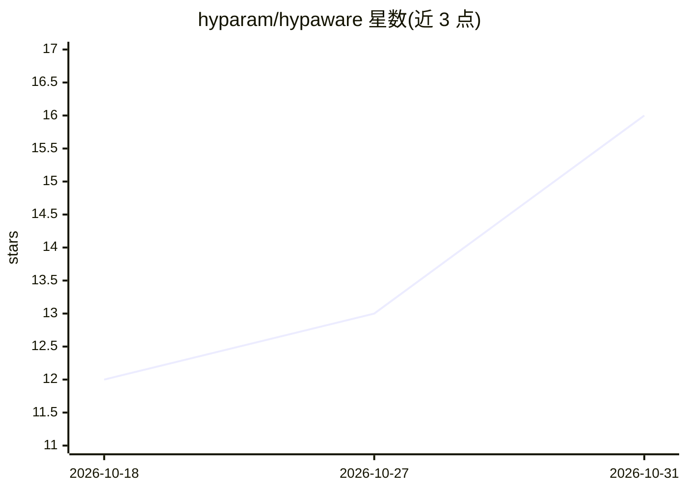

# hyparam/hypaware

⭐ 16 · JavaScript · MIT · 推送 2026-10-30 · [GitHub](https://github.com/hyparam/hypaware) · [官网](https://hypaware.ai) · 组织维护

**AI 客户端会话录制与分析工具：把各 agent 历史变成可查询数据**

面向使用 Claude Code、Codex、Cursor 等 AI 编程客户端的开发者：后台守护进程在本地录制会话，存入开放表格文件并组织为会话、仓库、文件、工具、技能的图结构；随后支持 SQL 与搜索查询、让 AI 客户端用自然语言回答历史问题、生成覆盖 token 用量/重复任务/工具失败的报告并提出改进项。可本地保存，也可同步至 HypAware Cloud 做团队分析；提供按文件夹的隐私控制。需 Node.js 22.12+，macOS/Linux，npm 全局安装。

## 筛选速览

| 维度 | 判定 | 备注 |
|---|---|---|
| AI 角色 | `ai-ecosystem` | LLM/agent 周边工具 |
| 许可风险 | `permissive` | MIT |
| 部署形态 | `library` | 以包/库形式分发 |
| 模型依赖 | local-ok | 支持本地模型 |
| 硬件要求 | — | 无带数字的原话,不猜 |
| 安装摩擦 | `low` | 无编译、无系统依赖或容器化 |
| 成熟度 | — | 结构信号不足 |

## 能力要点

- 后台守护进程录制 Claude Code、Codex、Cursor、Ollama 等客户端会话到本地开放表格文件
- SQL/关键词查询历史，或让 AI 客户端以自然语言回答关于历史的问题
- 生成 token 用量、重复任务、工具失败分析与改进建议报告
- 按文件夹粒度的隐私控制与本地优先存储，可选同步 HypAware Cloud

## 适用场景

- 查询过去哪些会话触碰了某个模块或出现过某类报错
- 复盘每周的 token 花费、重复调试工作与工具失败
- 基于历史会话让 agent 提议值得新增的技能
- 团队层面汇总分析各成员 AI 使用与失败模式

## 场景标签

`LLM 可观测性` · 领域:评测与运维

## 证据(README 行号)

> L8: - **Collect.** A lightweight background daemon captures sessions from the
> L12: - **Analyze.** Query everything with SQL or search, or have your client
> L75: Reports review your AI work over a period: token usage, recurring tasks, tool

## 星数曲线

2026-10-18 12 → 2026-10-31 16（+4）

---
*卡片 v1 · prompt 1.4 · 生成 2026-10-30 · 置信度 high · 依据 README sha `df381da9f1b5` · [字段定义](../../DATASET.md)*
