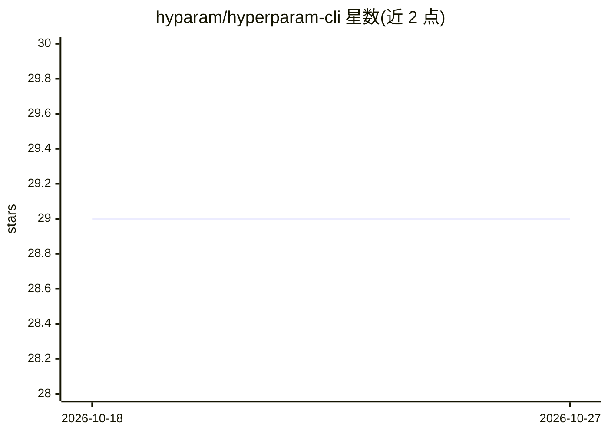

# hyparam/hyperparam-cli

⭐ 29 · TypeScript · MIT · 推送 2026-09-21 · [GitHub](https://github.com/hyparam/hyperparam-cli) · [官网](https://hyperparam.app) · 组织维护

**在浏览器中浏览分析本地大数据集的 CLI 工具**

基于 npm 分发的命令行工具：启动本地文件浏览器，在网页中打开当前目录、指定文件、文件夹或 URL，支持 parquet 等大数据集的探索与分析；同时提供 CLI chat 会话功能。面向需要查看本地数据集（如 parquet/jsonl）的开发者，包内 lib/ 目录还提供可复用的组件库（如 parquetDataFrame）。README 声明该 CLI 目前仅供开发测试用途，建议使用 hyperparam.app。

## 筛选速览

| 维度 | 判定 | 备注 |
|---|---|---|
| AI 角色 | `ai-enhanced` | 去掉 AI 部分产品仍成立 |
| 许可风险 | `permissive` | MIT |
| 部署形态 | `library` | 以包/库形式分发 |
| 模型依赖 | — | README 未给出锁定关系 |
| 硬件要求 | — | 无带数字的原话,不猜 |
| 安装摩擦 | `low` | 无编译、无系统依赖或容器化 |
| 成熟度 | — | 结构信号不足 |

## 能力要点

- npx hyperparam 一行命令在浏览器打开本地文件浏览器
- 支持打开本地文件、目录及远程 URL 的 parquet 数据
- 包内含可复用 JS 组件库（asyncBufferFrom、parquetDataFrame 等）
- 附带 CLI chat 会话模式

## 适用场景

- 本地浏览和检查 parquet/csv 等大文件数据集
- 不下载直接查看远程 URL 数据集
- 在自己的前端应用中复用数据集加载组件

## 场景标签

 · 领域:数据工具/机器学习数据

## 证据(README 行号)

> L8: Hyperparam is a tool for exploring and analyzing large datasets in the browser.
> L33: npx hyperparam chat

## 星数曲线

2026-10-18 29 → 2026-10-27 29（+0）

---
*卡片 v1 · prompt 1.4 · 生成 2026-10-26 · 置信度 mid · 依据 README sha `18a22c61a9cb` · [字段定义](../../DATASET.md)*
