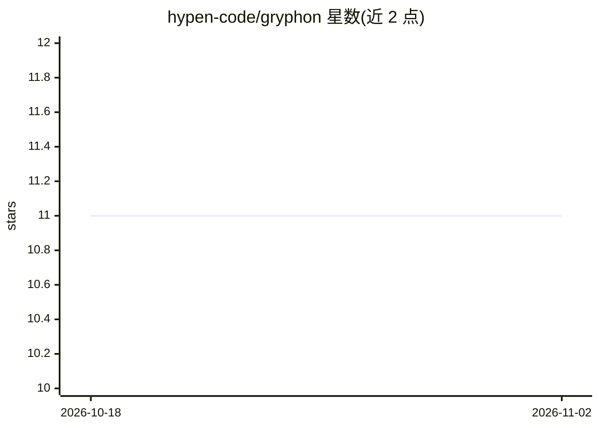

# hypen-code/gryphon

⭐ 11 · Python · MIT · 推送 2026-09-13 · [GitHub](https://github.com/hypen-code/gryphon) · 组织维护

**把 OpenAPI 目录编译为 MCP 元工具并受治运行受限 Python 的代理网关**

面向 AI agent 的 API 接入治理层：将 OpenAPI/Swagger 目录编译为一小组元工具（而非每端点一个 MCP 工具），让 agent 按需发现、检视、执行 API 调用并复用结果；受限 Python 执行由持有凭据的宿主 broker 承担，凭据不进入 agent。提供四种运行模式：本地 stdio（无需 Docker/数据库）、SQLite 本地 SaaS（浏览器 UI、租户/通道/密钥管理）、Docker Compose + PostgreSQL 托管模式、遗留 operator HTTP。限 Linux/macOS、Python 3.13+；SaaS 模式需系统 libpq；无 PyPI 或容器镜像发布。

## 筛选速览

| 维度 | 判定 | 备注 |
|---|---|---|
| AI 角色 | `ai-ecosystem` | LLM/agent 周边工具 |
| 许可风险 | `permissive` | MIT |
| 部署形态 | `self-host` | docker 或自建部署 |
| 模型依赖 | — | README 未给出锁定关系 |
| 硬件要求 | — | 无带数字的原话,不猜 |
| 安装摩擦 | `low` | 无编译、无系统依赖或容器化 |
| 成熟度 | — | 结构信号不足 |

## 能力要点

- OpenAPI → discover → inspect → execute → reuse 的元工具编译流程
- 凭据保留在宿主 broker，agent 侧不接触
- 四种运行模式：stdio / 本地 SQLite SaaS / Docker+PostgreSQL 托管 / 遗留 HTTP
- 租户、通道、密钥哈希存储、审计与读/写权限分离的治理机制

## 适用场景

- 让 MCP 客户端中的 agent 通过统一元工具调用已治理的 API 目录
- 在本地 stdio 模式下做无凭据的离线受限计算
- 以多租户 Web UI 托管 API 规格、通道密钥与用量审计

## 场景标签

`Agent 框架` · 领域:Agent 开发

## 证据(README 行号)

> L9: Gryphon is the guardian between agent-generated code and API authority:
> L10: **compile OpenAPI → discover → inspect → execute → reuse**, with a small set of
> L15: |Local stdio|Checkout + `uv run --frozen gryphon stdio`|One MCP entry; no Docker, database server, model key, or we

## 星数曲线

2026-10-18 11 → 2026-11-02 11（+0）

---
*卡片 v1 · prompt 1.4 · 生成 2026-11-02 · 置信度 mid · 依据 README sha `67b38b8c5397` · [字段定义](../../DATASET.md)*
