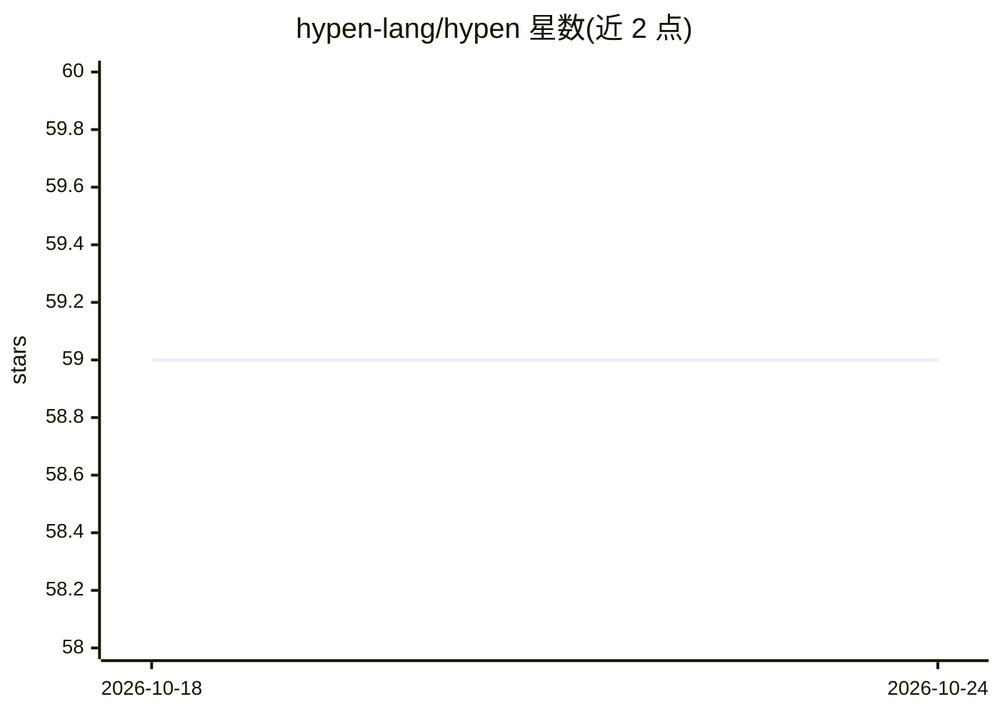

# hypen-lang/hypen

⭐ 59 · Rust · MIT · 推送 2026-10-24 · [GitHub](https://github.com/hypen-lang/hypen) · [官网](https://hypen.space) · 组织维护

**声明式跨平台 UI 语言与引擎，一套 UI 流式渲染到各端**

Hypen 是开源的声明式 UI 语言（DSL）与引擎：用 Rust 编写的解析器与响应式引擎（编译为 WASM），将 DSL 转为 AST/IR 并 diff 出补丁，发送到各平台原生渲染器（Web DOM/Canvas、SwiftUI、Jetpack Compose）。服务端 SDK 覆盖 TypeScript、Go、Rust、Swift、Kotlin/JVM，通过 WebSocket 补丁协议通信。内置响应式、路由、热重载、预览 Studio 与 Tailwind 简写；README 称语言设计对人类与 LLM 均易学，供开发者构建跨平台应用。部分能力（如多语言原生流式）标注 coming soon。

## 筛选速览

| 维度 | 判定 | 备注 |
|---|---|---|
| AI 角色 | `ai-enhanced` | 去掉 AI 部分产品仍成立 |
| 许可风险 | `permissive` | MIT |
| 部署形态 | `None` |  |
| 模型依赖 | — | README 未给出锁定关系 |
| 硬件要求 | — | 无带数字的原话,不猜 |
| 安装摩擦 | `low` | 无编译、无系统依赖或容器化 |
| 成熟度 | `idea` | |

## 能力要点

- 一套 DSL 通过补丁协议渲染到 Web/iOS/Android 原生端
- 5 种服务端 SDK（TS/Go/Rust/Swift/Kotlin）共享同一模块系统
- 内置响应式、路由、热重载、预览 Studio、Tailwind 简写
- 声明语言设计目标包含对 LLM 友好易学

## 适用场景

- 用一套声明式 UI 代码覆盖 Web 与移动原生平台
- 在后端语言中定义有状态模块并流式推送 UI
- 让 LLM 学习并生成 Hypen 应用代码

## 场景标签

 · 领域:跨平台 UI 框架/编程语言

## 证据(README 行号)

> L12:  An open-source cross-platform language and engine for building universal software that runs natively on all platfo
> L21: - **Developer and LLM friendly** — Hypen was designed to be easy to learn and use for both humans and machines, all

## 星数曲线

2026-10-18 59 → 2026-10-24 59（+0）

---
*卡片 v1 · prompt 1.4 · 生成 2026-10-24 · 置信度 mid · 依据 README sha `0ebd60fdf719` · [字段定义](../../DATASET.md)*
