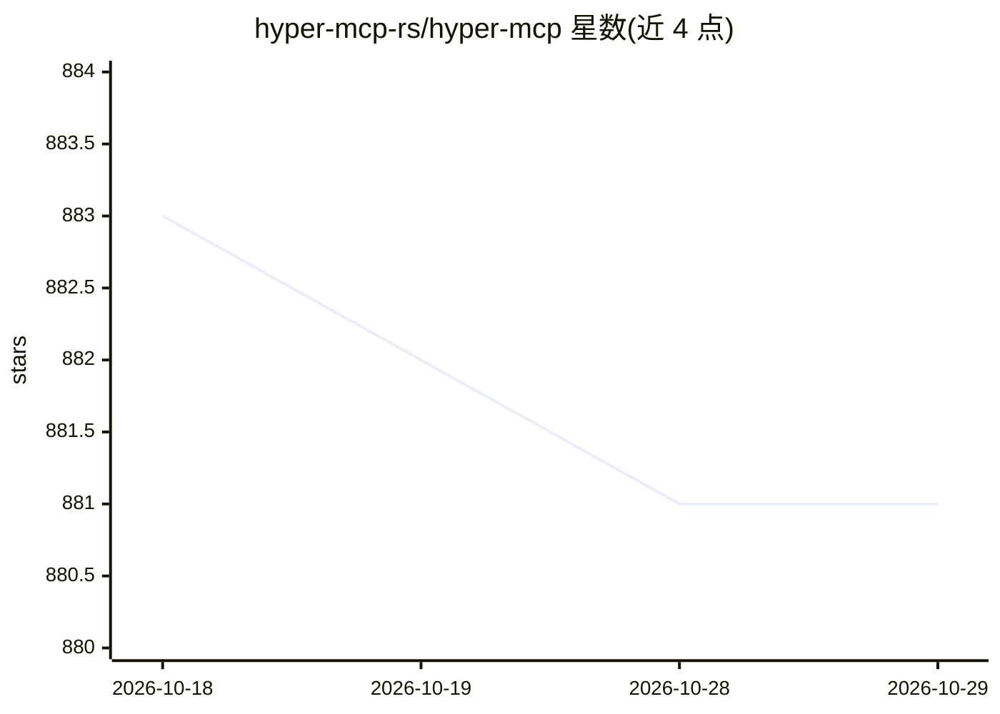

# hyper-mcp-rs/hyper-mcp

⭐ 881 · Rust · Apache-2.0 · 推送 2026-10-28 · [GitHub](https://github.com/hyper-mcp-rs/hyper-mcp) · 组织维护

**通过 WebAssembly 插件扩展能力的 MCP 服务器**

用 Rust 编写的 MCP 服务器，通过基于 Extism 的 WebAssembly 插件机制为 Claude Desktop、Cursor IDE 等 MCP 兼容应用扩展工具能力。插件可用任意可编译到 WASM 的语言编写，经 OCI 容器 registry 分发并以 sigstore/cosign 做签名校验，运行于沙箱并可限制网络、文件系统与内存访问；支持 stdio 传输、动态加载/卸载插件与工具名前缀防冲突。安装途径含 Homebrew、GitHub Releases 预编译二进制（含 .mcpb 包）与 cargo；加载 oci:// 插件需系统安装 cosign。内置 20 余个官方/社区插件。

## 筛选速览

| 维度 | 判定 | 备注 |
|---|---|---|
| AI 角色 | `ai-ecosystem` | LLM/agent 周边工具 |
| 许可风险 | `permissive` | Apache-2.0 |
| 部署形态 | `desktop` | 安装包/桌面程序 |
| 模型依赖 | — | README 未给出锁定关系 |
| 硬件要求 | — | 无带数字的原话,不猜 |
| 安装摩擦 | `low` | 无编译、无系统依赖或容器化 |
| 成熟度 | — | 结构信号不足 |

## 能力要点

- 任意 WASM 语言编写插件，经 OCI registry 分发
- 插件沙箱：限制网络/文件系统/内存访问，sigstore 签名校验
- 动态插件加载/卸载与工具名前缀防冲突
- 提供 Homebrew、预编译二进制、cargo 及 Claude Desktop .mcpb 一键安装包

## 适用场景

- 为 Claude Desktop、Cursor IDE 等 MCP 客户端接入自定义工具
- 以沙箱化 WASM 插件形式安全扩展 AI 应用能力
- 在资源受限的边缘/IoT 环境运行轻量 MCP 服务

## 场景标签

`Agent 框架` · 领域:Agent 开发

## 证据(README 行号)

> L12: A fast, secure MCP server that extends its capabilities through WebAssembly plugins.
> L16: hyper-mcp makes it easy to add AI capabilities to your applications. It works with Claude Desktop, Cursor IDE, and 
> L20: - Write plugins in any language that compiles to WebAssembly

## 星数曲线

2026-10-18 883 → 2026-10-29 881（-2）

---
*卡片 v1 · prompt 1.4 · 生成 2026-10-21 · 置信度 high · 依据 README sha `7739ac3104cb` · [字段定义](../../DATASET.md)*
