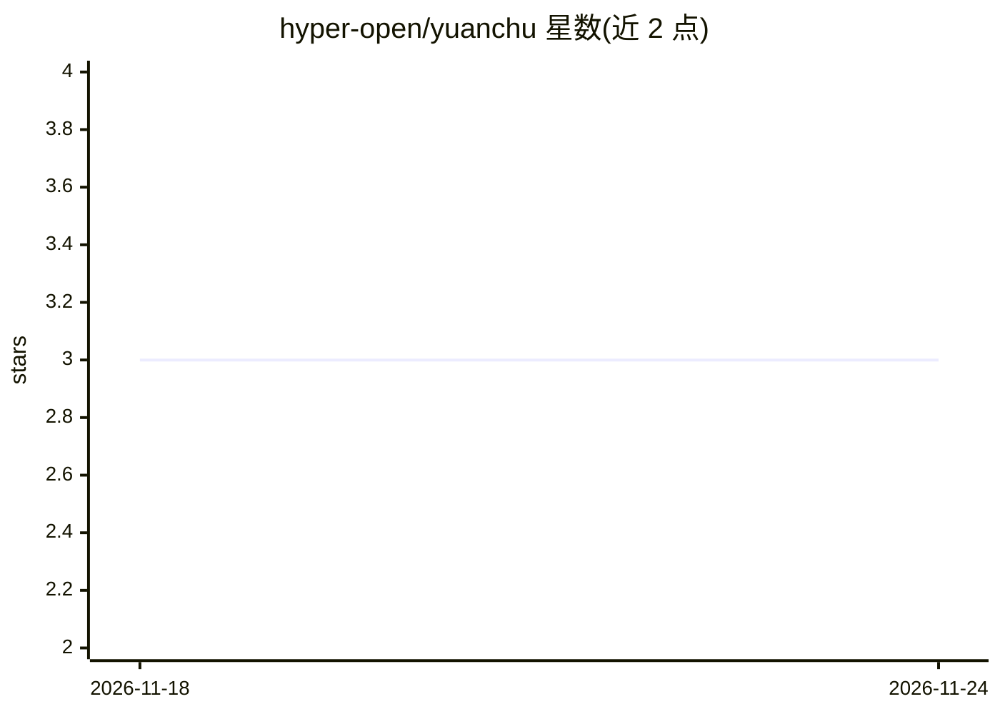

# hyper-open/yuanchu

⭐ 3 · Python · Apache-2.0 · 推送 2026-10-21 · [GitHub](https://github.com/hyper-open/yuanchu) · 组织维护 · 中文 README

**小说转短剧的 AI 生成工作台：分镜、关键帧、成片一站式流水线**

面向短剧内容创作者与团队的开源生成工作台，流水线覆盖章节提取分镜、资产/对白确认、关键帧与视频生成。内置 langgraph ReAct 代理编排、无限画布节点工作流、多租户 RBAC、Celery 任务中心。BYO Key 模式：平台不代采模型，用户自配文本/图像/视频/TTS 供应商凭证，扣费发生在自有账号。增值模块（机审/备案/计费）以闭源包随商业授权分发，开源版对应入口返回 501。Docker Compose 分组部署，含种子数据与健康检查。

## 筛选速览

| 维度 | 判定 | 备注 |
|---|---|---|
| AI 角色 | `ai-native` | 本体是模型或模型工具 |
| 许可风险 | `permissive` | Apache-2.0 |
| 部署形态 | `self-host` | docker 或自建部署 |
| 模型依赖 | — | README 未给出锁定关系 |
| 硬件要求 | — | 无带数字的原话,不猜 |
| 安装摩擦 | `low` | 无编译、无系统依赖或容器化 |
| 成熟度 | — | 结构信号不足 |

## 能力要点

- 小说→分镜→关键帧→视频的生成流水线，配就绪度前置校验
- 多供应商生成网关：文本/图像/视频/TTS 全品类，供应商与模型可插拔、按能力路由
- langgraph ReAct Agent 编排 + 无限画布节点式工作流
- 多租户与 RBAC、Celery 异步任务中心、BYO Key 成本模型

## 适用场景

- 把小说/剧本批量转成分镜与成片素材
- 团队协作管理短剧项目与生成任务配额
- 自配各家模型凭证搭建内部内容生产平台

## 场景标签

`视频生成` `工作流自动化` `图像生成` · 领域:效率与自动化

## 证据(README 行号)

> L1: # 沅楚 YuanChu · AI 短剧生成工作台（开源版）
> L8: - **多供应商生成网关**：文本 / 图像 / 视频 / TTS 全品类，BYO Key（自带凭证），供应商与模型可插拔，按能力路由
> L137: - **不在本仓库**：平台管理端（运营后台）、商业增值模块（内容机审、AIGC 合规留痕、微短剧备案辅助、订阅计费）——以闭源包随商业授权分发（部署见 deploy/compose/parts/commercial.yml）

## 星数曲线

2026-11-18 3 → 2026-11-24 3（+0）

---
*卡片 v1 · prompt 1.4 · 生成 2026-11-21 · 置信度 high · 依据 README sha `df8acd7ce4cd` · [字段定义](../../DATASET.md)*
