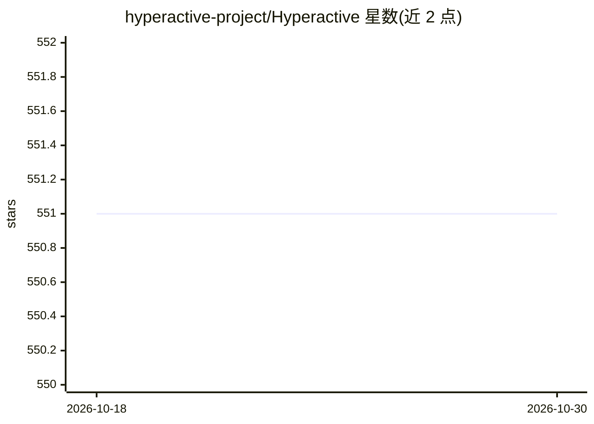

# hyperactive-project/Hyperactive

⭐ 551 · Python · MIT · 推送 2026-09-14 · [GitHub](https://github.com/hyperactive-project/Hyperactive) · [官网](https://hyperactive.readthedocs.io/en/latest/#) · 个人维护

**统一接口的优化算法库：31 种算法用于调参与黑盒优化**

Python 优化算法统一接口库，提供 31 种算法（局部、全局、种群、模型式），跨 GFO、Optuna、scikit-learn 三个后端。核心机制是将优化问题（实验）与算法分离，可在不改动实验代码的情况下替换优化器；支持离散、连续与混合搜索空间。原生集成 scikit-learn、sktime、skpro 与 PyTorch，面向超参数调优、模型选择与黑盒优化场景，2019 年起持续维护。

## 筛选速览

| 维度 | 判定 | 备注 |
|---|---|---|
| AI 角色 | `ai-ecosystem` | LLM/agent 周边工具 |
| 许可风险 | `permissive` | MIT |
| 部署形态 | `library` | 以包/库形式分发 |
| 模型依赖 | — | README 未给出锁定关系 |
| 硬件要求 | — | 无带数字的原话,不猜 |
| 安装摩擦 | `low` | 无编译、无系统依赖或容器化 |
| 成熟度 | — | 结构信号不足 |

## 能力要点

- 31 种优化算法跨 3 个后端（GFO、Optuna、scikit-learn）统一 API
- 实验与算法分离，可替换优化器而不改实验代码
- 原生集成 scikit-learn、sktime、skpro、PyTorch
- 支持离散、连续与混合参数类型的搜索空间

## 适用场景

- 调优 scikit-learn 或 PyTorch 模型的超参数
- 通过贝叶斯优化或粒子群等算法求解黑盒优化问题
- 为时间序列模型（sktime）做模型选择与调参

## 场景标签

 · 领域:机器学习工具/优化

## 证据(README 行号)

> L32: **Hyperactive** provides 31 optimization algorithms across 3 backends (GFO, Optuna, scikit-learn), accessible throu
> L34: Designed for hyperparameter tuning, model selection, and black-box optimization. Native integrations with scikit-le

## 星数曲线

2026-10-18 551 → 2026-10-30 551（+0）

---
*卡片 v1 · prompt 1.4 · 生成 2026-10-21 · 置信度 high · 依据 README sha `fe313147ce25` · [字段定义](../../DATASET.md)*
