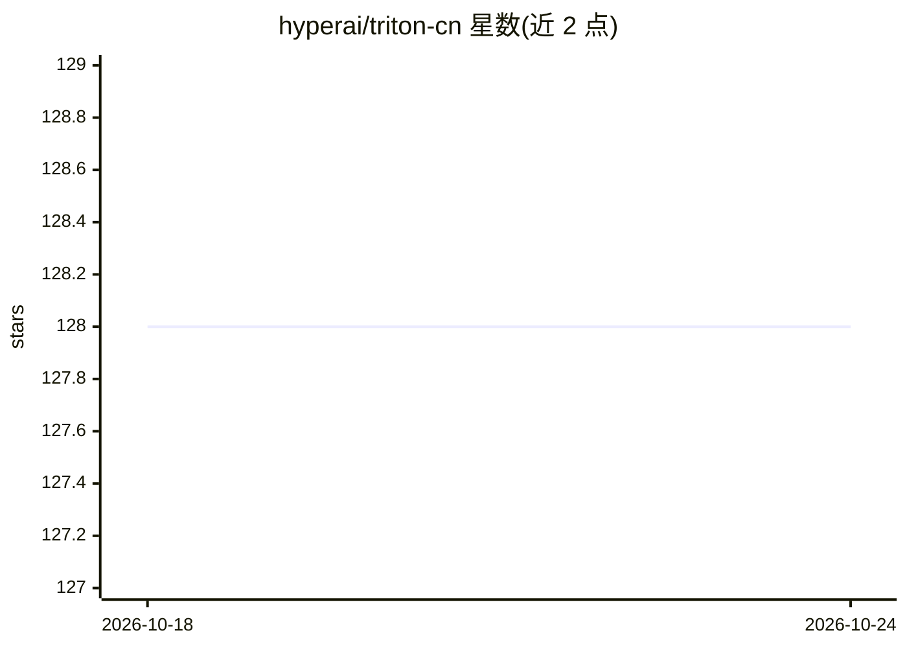

# hyperai/triton-cn

⭐ 128 · TypeScript · MIT · 推送 2026-03-05 · [GitHub](https://github.com/hyperai/triton-cn) · [官网](https://triton.hyper.ai) · 组织维护 · 中文 README

**Triton 中文文档翻译项目：GPU 内核编程语言的学习资料**

由 hyperai 维护的 Triton 官方文档中文翻译项目。Triton 是基于 Python 的并行编程语言和编译器，用于编写在现代 GPU 上运行的 DNN 计算内核。该项目随官方文档更新同步修订，开发者可提交 issue/PR 修正翻译、认领翻译任务或加入中文社区。文档站基于 Docusaurus 构建，本地开发需 Node.js 与 pnpm，通过 pnpm install / pnpm start 运行，并支持用 docusaurus 命令创建新版本。

## 筛选速览

| 维度 | 判定 | 备注 |
|---|---|---|
| AI 角色 | `ai-knowledge` | 知识聚合/清单类 |
| 许可风险 | `permissive` | MIT |
| 部署形态 | `library` | 以包/库形式分发 |
| 模型依赖 | — | README 未给出锁定关系 |
| 硬件要求 | — | 无带数字的原话,不猜 |
| 安装摩擦 | `low` | 无编译、无系统依赖或容器化 |
| 成熟度 | — | 结构信号不足 |

## 能力要点

- Triton 官方文档的中文翻译，随官方更新同步修订
- 基于 Docusaurus 构建，支持多版本文档管理
- 开放 issue/PR 协作与翻译认领机制

## 适用场景

- 系统性学习 Triton 的 GPU 内核编程
- 查阅 Triton 中文 API 文档
- 参与文档翻译与中文社区协作

## 场景标签

`教程课程` · 领域:学习与行业

## 证据(README 行号)

> L4: Triton 是一种用于并行编程的语言和编译器，旨在提供一个基于 Python 的编程环境，以高效编写自定义 DNN 计算内核，并能够在现代 GPU 硬件上以最大吞吐量运行。
> L6: 由于现有 Triton 相关的中文学习资料较为零散，不便于开发者系统性学习，我们在 GitHub 上创建了 Triton 文档翻译项目。

## 星数曲线

2026-10-18 128 → 2026-10-24 128（+0）

---
*卡片 v1 · prompt 1.4 · 生成 2026-10-22 · 置信度 mid · 依据 README sha `1e862216f721` · [字段定义](../../DATASET.md)*
