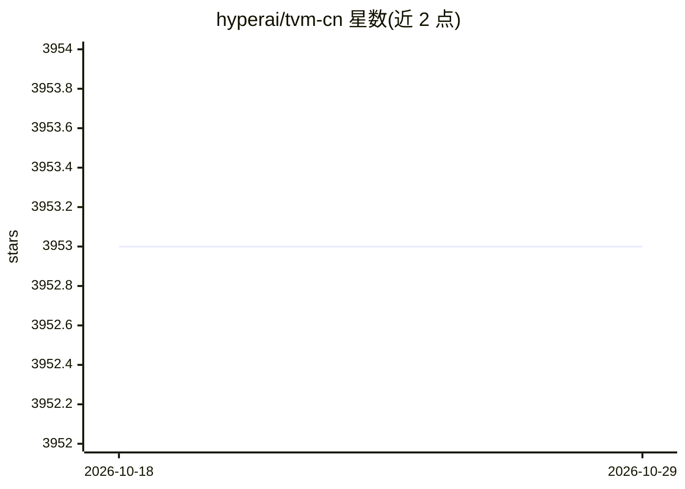

# hyperai/tvm-cn

⭐ 3,953 · TypeScript · Apache-2.0 · 推送 2026-05-20 · [GitHub](https://github.com/hyperai/tvm-cn) · [官网](https://tvm.hyper.ai) · 组织维护 · 中文 README

**Apache TVM 官方文档的中文翻译项目**

基于 TVM v0.10.0 的中文文档本土化项目，覆盖 TVM（开源深度学习编译器，支持 CPU、GPU、ARM 等硬件架构）的系统性学习资料。项目基于 Docusaurus 构建，本地开发需安装 Node.js 与 pnpm，支持社区通过 issue/PR 修正翻译、认领翻译任务与版本管理（如 pnpm run docusaurus docs:version）。旧 Sphinx 构建方式标记为 Deprecated。

## 筛选速览

| 维度 | 判定 | 备注 |
|---|---|---|
| AI 角色 | `ai-knowledge` | 知识聚合/清单类 |
| 许可风险 | `permissive` | Apache-2.0 |
| 部署形态 | `library` | 以包/库形式分发 |
| 模型依赖 | — | README 未给出锁定关系 |
| 硬件要求 | — | 无带数字的原话,不猜 |
| 安装摩擦 | `low` | 无编译、无系统依赖或容器化 |
| 成熟度 | — | 结构信号不足 |

## 能力要点

- 基于 TVM v0.10.0 的系统性中文文档
- 基于 Docusaurus 构建，支持多版本文档管理
- 社区共建模式：认领翻译、提交 issue/PR

## 适用场景

- 用中文系统学习 Apache TVM 深度学习编译器
- 参与 TVM 文档翻译与开源共建
- 追踪 TVM 中文文档随官方版本的更新

## 场景标签

`教程课程` · 领域:学习与行业

## 证据(README 行号)

> L1: # Apache TVM 中文文档
> L8: TVM 是一个开源的深度学习编译器，适用于 CPU、GPU、ARM 等多种硬件架构，旨在使机器学习工程师能够在任意硬件后端，高效地运行并优化计算。
> L10: 鉴于 TVM 相关的中文学习资料比较零散，不利于开发者系统性学习，我们在 GitHub 上创建了 TVM 文档翻译项目。

## 星数曲线

2026-10-18 3,953 → 2026-10-29 3,953（+0）

---
*卡片 v1 · prompt 1.4 · 生成 2026-10-20 · 置信度 mid · 依据 README sha `20fd638d6423` · [字段定义](../../DATASET.md)*
