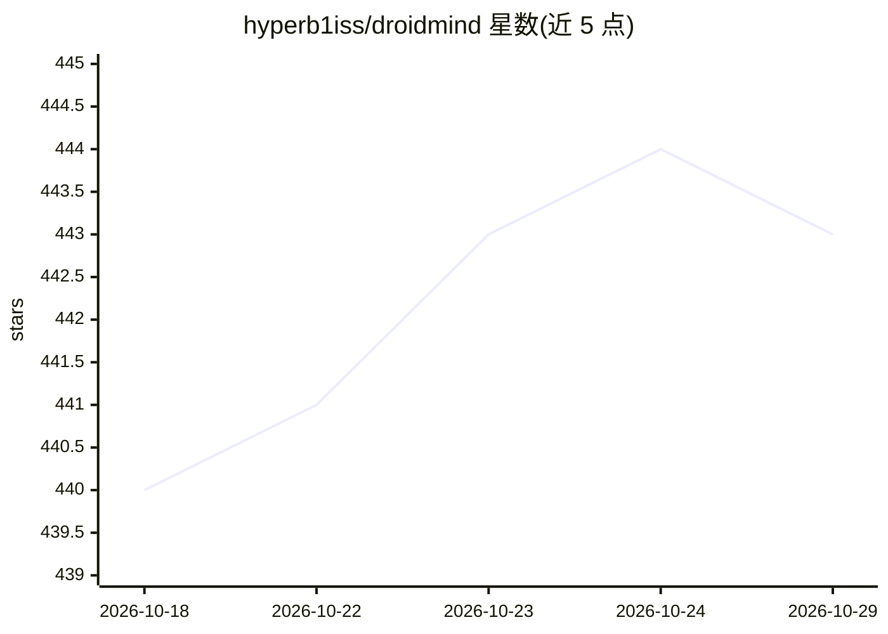

# hyperb1iss/droidmind

⭐ 443 · Python · Apache-2.0 · 推送 2026-01-07 · [GitHub](https://github.com/hyperb1iss/droidmind) · [官网](https://hyperb1iss.github.io/droidmind/) · 个人维护

**通过 MCP 让 AI 助手控制与调试 Android 设备的桥接服务器**

实现 Model Context Protocol 的 Python 服务器，把 AI 助手（Claude、Cursor、Cline 等 MCP 兼容客户端）经 ADB 连接到 Android 设备，用自然语言完成设备管理、日志/崩溃分析、文件读写、应用安装卸载、UI 自动化点击滑动与 shell 命令执行。内置命令校验、风险分级与受保护路径等安全机制，高风险操作默认拦截。支持 uvx 免安装接入 IDE、源码安装（stdio/SSE 传输）与 Docker 运行；要求 Python 3.13、系统装有 ADB 并开启设备 USB 调试。

## 筛选速览

| 维度 | 判定 | 备注 |
|---|---|---|
| AI 角色 | `ai-ecosystem` | LLM/agent 周边工具 |
| 许可风险 | `permissive` | Apache-2.0 |
| 部署形态 | `None` |  |
| 模型依赖 | — | README 未给出锁定关系 |
| 硬件要求 | — | 无带数字的原话,不猜 |
| 安装摩擦 | `low` | 无编译、无系统依赖或容器化 |
| 成熟度 | — | 结构信号不足 |

## 能力要点

- 通过 ADB 实现设备管理、文件操作、应用控制、UI 自动化与 shell 执行
- 兼容任意 MCP 客户端（Claude、Cursor、Cline 等），uvx 零安装接入 IDE
- 命令校验、风险分级、受保护路径等安全框架，高风险操作默认拦截
- 支持 stdio 与 SSE 两种传输方式及 Docker 容器化运行

## 适用场景

- 让 IDE 里的 AI 助手直接在我连接的 Android 设备上装 APK、抓日志、调试崩溃
- 用自然语言驱动 UI 自动化（点击、滑动、输入文本）
- 在 agentic coding 工作流中把真机纳入构建与调试闭环

## 场景标签

`GUI 自动化` · 领域:效率与自动化

## 证据(README 行号)

> L14: **Control Android devices with AI through the Model Context Protocol**
> L29: - 💬 **Integrate Seamlessly**: Connect with any MCP-compatible client (Claude, Cursor, Cline, etc.).

## 星数曲线

2026-10-18 440 → 2026-10-29 443（+3）

---
*卡片 v1 · prompt 1.4 · 生成 2026-10-21 · 置信度 high · 依据 README sha `a11001915731` · [字段定义](../../DATASET.md)*
