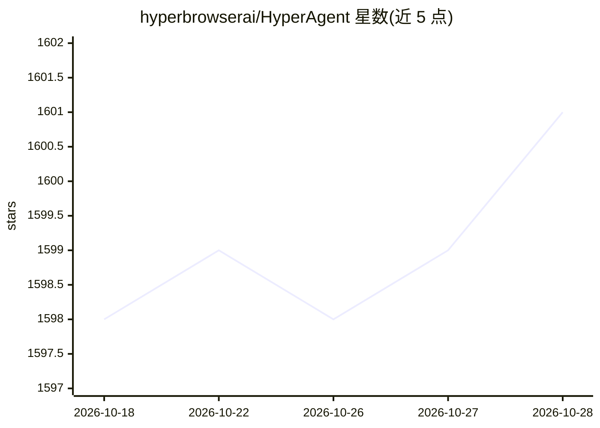

# hyperbrowserai/HyperAgent

⭐ 1,601 · TypeScript · NOASSERTION · 推送 2026-05-11 · [GitHub](https://github.com/hyperbrowserai/HyperAgent) · [官网](https://www.hyperbrowser.ai/) · 组织维护

**给开发者的 LLM 驱动浏览器自动化库（Playwright+AI）**

基于 Playwright/CDP 的浏览器自动化库，提供 page.perform()（单步动作，无截图、单次 LLM 调用）与 page.ai()（多步复杂任务，可用截图）两套 API，支持自然语言命令、结构化数据抽取、隐身模式、自定义动作与 MCP 客户端。支持 OpenAI 等多种 LLM 提供商，本地浏览器或 Hyperbrowser 云端均可运行。内置动作缓存，可录回放工作流并生成独立回放脚本，实现无 LLM 调用的确定性回放。以 npm 包与 CLI（npx）形式提供。CDP 层仍为实验性，可关闭回退到 Playwright 原生定位。

## 筛选速览

| 维度 | 判定 | 备注 |
|---|---|---|
| AI 角色 | `ai-ecosystem` | LLM/agent 周边工具 |
| 许可风险 | `none` | NOASSERTION |
| 部署形态 | `library` | 以包/库形式分发 |
| 模型依赖 | — | README 未给出锁定关系 |
| 硬件要求 | — | 无带数字的原话,不猜 |
| 安装摩擦 | `low` | 无编译、无系统依赖或容器化 |
| 成熟度 | `idea` | |

## 能力要点

- page.perform() 与 page.ai() 双模式自然语言自动化 API
- 动作缓存：录制后 XPath 确定性回放，无需 LLM 调用，可生成独立回放脚本
- 原生 CDP 支持：精确坐标、深层 iframe 追踪、广告 iframe 过滤
- MCP 客户端与自定义动作扩展；多 LLM 提供商原生 SDK 支持

## 适用场景

- 用自然语言指令替代脚本完成网页操作与数据抽取
- 录制工作流后在 CI 中做无 LLM 成本的回归测试
- 通过 MCP 工具把网页数据写入 Google Sheets 等外部服务

## 场景标签

`浏览器自动化` · 领域:效率与自动化

## 证据(README 行号)

> L20: Hyperagent is Playwright supercharged with AI. No more brittle scripts, just powerful natural language commands.
> L27: - 🤖 **AI Commands**: Simple APIs like `page.ai()`, `page.extract()` and `executeTask()` for any AI automation
> L180: Hyperagent supports multiple LLM providers with native SDKs for better performance and reliability.

## 星数曲线

2026-10-18 1,598 → 2026-10-28 1,601（+3）

---
*卡片 v1 · prompt 1.4 · 生成 2026-10-21 · 置信度 high · 依据 README sha `7dcf6b7a942b` · [字段定义](../../DATASET.md)*
