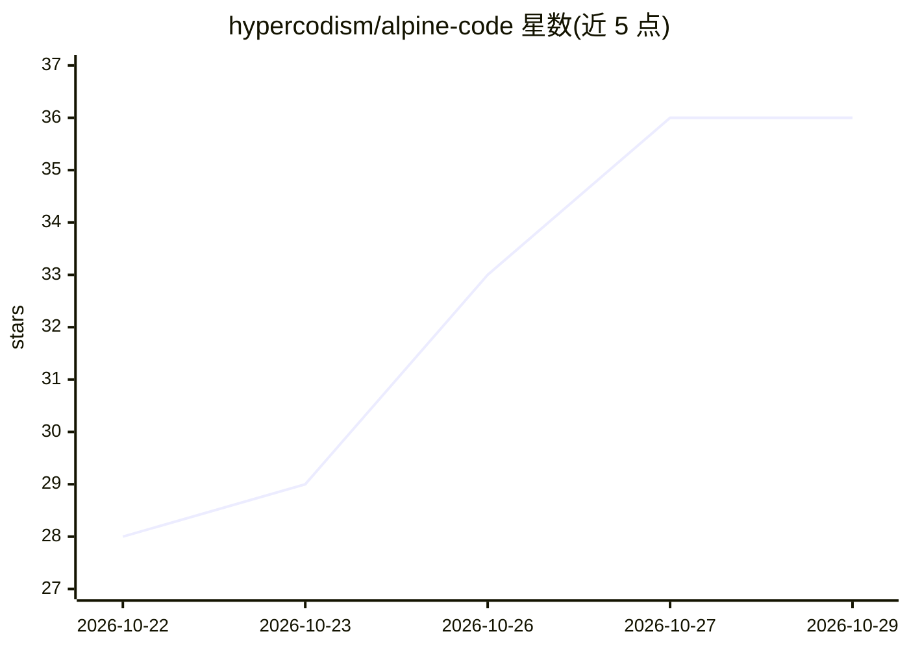

# hypercodism/alpine-code

⭐ 36 · TypeScript · MIT · 推送 2026-10-22 · [GitHub](https://github.com/hypercodism/alpine-code) · 个人维护

**面向非开发者的开源桌面 AI 编程代理（Mac）**

MIT 许可的开源桌面端 coding agent，附图形界面：打开本地文件夹后用自然语言下达指令，代理读取文件、做修改并检查是否可运行。面向不编程的用户提供平语说明、改动前确认（Allow/Always allow/Skip）、逐行变更面板与成本/记忆占用显示；面向开发者提供可自定义的 Agent 构建（模型+指令+工具）、AGENTS.md 约定读取、OpenAI 兼容服务器接入，核心以 Python 包 alpine-code-core 形式存在，桌面端经 JSON-RPC 通信。模型可接 ChatGPT 订阅、API key 或本机 Ollama/LM Studio/vLLM。目前仅支持 Apple silicon Mac（M1+，macOS 11+），Windows 未发布。

## 筛选速览

| 维度 | 判定 | 备注 |
|---|---|---|
| AI 角色 | `ai-native` | 本体是模型或模型工具 |
| 许可风险 | `permissive` | MIT |
| 部署形态 | `desktop` | 安装包/桌面程序 |
| 模型依赖 | local-ok | 支持本地模型 |
| 硬件要求 | — | 无带数字的原话,不猜 |
| 安装摩擦 | `low` | 无编译、无系统依赖或容器化 |
| 成熟度 | — | 结构信号不足 |

## 能力要点

- 自然语言下达指令，自动读文件、改代码并验证可运行
- 改动前逐行确认（Allow/Always allow/Skip）与逐行变更记录
- 支持 ChatGPT 订阅登录、多厂商 API key 及本机 Ollama/LM Studio/vLLM
- 核心 alpine-code-core 独立于 UI，经 JSON-RPC 协议可接其他前端

## 适用场景

- 不会编程的人用自然语言修改或搭建自己的项目/网站
- 开发者构建带自定义工具与指令的 Agent 处理不同任务
- 本地运行模型（如 Ollama）完成代码修改，数据不出本机

## 场景标签

`编码 Agent` · 领域:编码与开发

## 证据(README 行号)

> L11: Alpine Code is an open-source AI coding agent for your desktop. Open a folder, say what you want, and it reads the
> L16: - **If you don't code**, it talks in plain words, asks before it changes anything and shows you everything it did.

## 星数曲线

2026-10-22 28 → 2026-10-29 36（+8）

---
*卡片 v1 · prompt 1.4 · 生成 2026-10-25 · 置信度 high · 依据 README sha `fe09cb4be252` · [字段定义](../../DATASET.md)*
