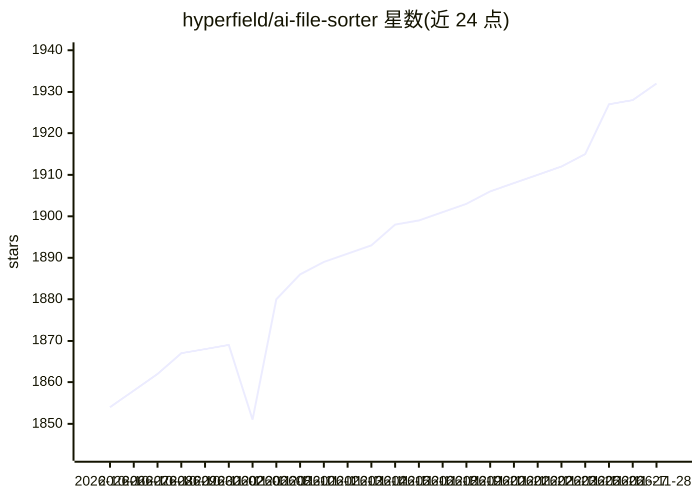

# hyperfield/ai-file-sorter

⭐ 1,932 · C++ · AGPL-3.0 · 推送 2026-11-27 · [GitHub](https://github.com/hyperfield/ai-file-sorter) · [官网](https://filesorter.app) · 个人维护

**用本地或远程 LLM 给文件分类与重命名的桌面应用**

跨平台桌面应用（Windows/macOS/Linux，Qt6 界面），对图片、文档、音视频文件生成分类与重命名建议：图片用内置视觉 LLM 分析画面内容，文档按文本内容起名，音视频读取内嵌元数据标签生成文件名。用户在预览表中逐条审核、可编辑可撤销，支持 dry-run 模式与 Undo last run。本地模型路径下数据不出设备、无遥测；API 模式会将分析数据发送到所配置的服务器。支持自定义 GGUF 模型、类别白名单、已有文件夹结构归类与 Johnny.Decimal 归档插件。

## 筛选速览

| 维度 | 判定 | 备注 |
|---|---|---|
| AI 角色 | `ai-native` | 本体是模型或模型工具 |
| 许可风险 | `viral` | AGPL-3.0 |
| 部署形态 | `desktop` | 安装包/桌面程序 |
| 模型依赖 | local-ok | 支持本地模型 |
| 硬件要求 | — | 无带数字的原话,不猜 |
| 安装摩擦 | `high` | 编译与系统依赖俱全 |
| 成熟度 | — | 结构信号不足 |

## 能力要点

- 内置视觉 LLM 后端（Qwen3.5 4B、Gemma 3 4B IT、LLaVA 1.6 Mistral 7B）分析图片内容生成文件名
- 完全本地运行的分类模式，无需联网或 API key
- dry-run 预览、审核确认前不改动文件、支持持久化撤销
- 支持注册自定义 GGUF 模型及 OpenAI/Gemini/OpenAI 兼容 API 接入

## 适用场景

- 整理杂乱的下载目录、外接硬盘或 NAS 存储
- 批量给截图和照片起描述性文件名
- 按已有文件夹结构归档并保持类别一致
- 离线环境下本地处理文件、数据不出本机

## 场景标签

 · 领域:文件管理/桌面工具

## 证据(README 行号)

> L20: AI File Sorter is a cross-platform desktop application that uses AI to organize files and suggest cleaner, more con
> L104: - **AI-powered categorization**: Sort files using either local AI models on your computer or remote models with yo
> L114: - **Grouped model selection**: The **Select LLM** dialog has a **Local LLMs** tab for built-in models and custom G

## 星数曲线

2026-10-26 1,854 → 2026-11-28 1,932（+78）

---
*卡片 v1 · prompt 1.4 · 生成 2026-11-23 · 置信度 high · 依据 README sha `1f1283d1c913` · [字段定义](../../DATASET.md)*
