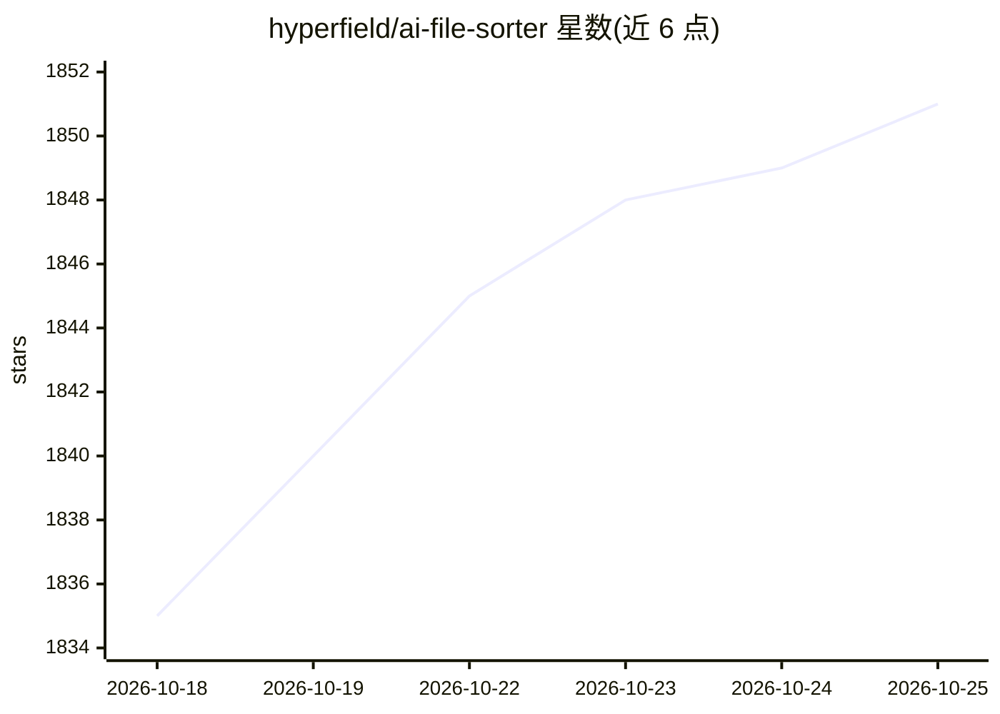

# hyperfield/ai-file-sorter

⭐ 1,854 · C++ · AGPL-3.0 · 推送 2026-10-19 · [GitHub](https://github.com/hyperfield/ai-file-sorter) · [官网](https://filesorter.app) · 个人维护 · 中文 README

**跨平台桌面应用：用本地/远程 AI 整理文件并建议重命名**

面向普通用户的 Windows/macOS/Linux 桌面应用，用 AI 对图片、文档和音视频文件做分类与重命名建议：内置视觉 LLM（默认 Gemma 3 4B IT，可选 LLaVA）分析图片内容生成描述性文件名，文本 LLM 分析文档内容，音视频则读取内嵌元数据生成规范化文件名。支持本地模型完全离线运行（无遥测），也可用自有 API key 接入 OpenAI/Gemini/OpenAI 兼容端点；所有变更需经用户审核确认，支持干跑预览与持久撤销，并可从审核决策中本地学习。Qt6 界面，提供 15 种界面语言。

## 筛选速览

| 维度 | 判定 | 备注 |
|---|---|---|
| AI 角色 | `ai-native` | 本体是模型或模型工具 |
| 许可风险 | `viral` | AGPL-3.0 |
| 部署形态 | `desktop` | 安装包/桌面程序 |
| 模型依赖 | local-ok | 支持本地模型 |
| 硬件要求 | `cpu-ok` | |
| 安装摩擦 | `high` | 编译与系统依赖俱全 |
| 成熟度 | — | 结构信号不足 |

## 能力要点

- 内置视觉 LLM 分析图片内容并生成描述性文件名（默认 Gemma 3 4B IT）
- 本地模型可完全离线运行，无需联网或 API key，无遥测
- 审核确认制：干跑预览、排序审核表、持久撤销、项目文件夹保护
- 白名单/分类模式/本地学习等一致性控制，支持自定义 GGUF 模型

## 适用场景

- 整理 Downloads、外接硬盘或 NAS 上的杂乱文件夹
- 把 IMG_2048.jpg 之类文件名换成描述性名称
- 用内嵌元数据规范化音视频文件命名
- 在不上传文件的前提下用本地模型分类图片和文档

## 场景标签

 · 领域:桌面工具/文件管理

## 证据(README 行号)

> L19: AI File Sorter is a cross-platform desktop application that uses AI to organize files and suggest cleaner, more con
> L111: - **AI-powered categorization**: Sort files using either local AI models on your computer or remote models with yo
> L119: - **Image content analysis (Visual LLM)**: Analyze supported picture files with built-in visual backends such as t

## 星数曲线

2026-10-18 1,835 → 2026-10-25 1,851（+16）

---
*卡片 v1 · prompt 1.4 · 生成 2026-10-21 · 置信度 high · 依据 README sha `5be8c9677cb2` · [字段定义](../../DATASET.md)*
