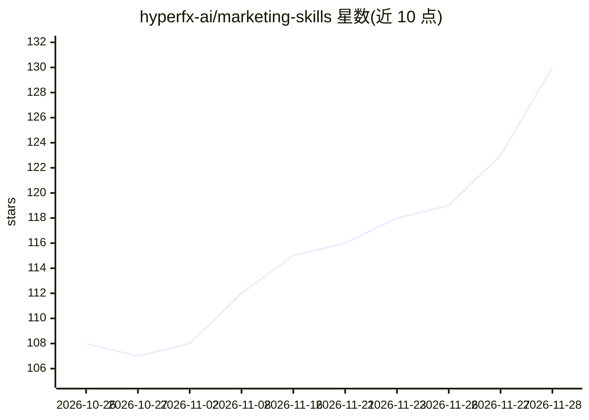

# hyperfx-ai/marketing-skills

⭐ 130 · Python · MIT · 推送 2026-11-26 · [GitHub](https://github.com/hyperfx-ai/marketing-skills) · [官网](https://www.hyperfx.ai/mcp) · 组织维护

**给 AI agent 装营销技能：投放、社媒、SEO、竞品与素材生成**

以 SKILL.md 形式发布的 24 个营销技能集合，覆盖付费广告（Google/Meta/TikTok/Amazon 等）、社媒发布、SEO 与竞品研究、广告素材与博客生成、冷邮件与生命周期邮件、GA4 分析等。技能通过 Hyper MCP 提供的 100+ 集成和内置工具执行，可在 Claude Code、Cursor、Codex 等支持 Agent Skills 规范的 agent 上运行；每个动作可配置审批规则。安装依赖 npx skills 命令，工具调用需配置相应平台集成。

## 筛选速览

| 维度 | 判定 | 备注 |
|---|---|---|
| AI 角色 | `ai-knowledge` | 知识聚合/清单类 |
| 许可风险 | `permissive` | MIT |
| 部署形态 | `library` | 以包/库形式分发 |
| 模型依赖 | — | README 未给出锁定关系 |
| 硬件要求 | — | 无带数字的原话,不猜 |
| 安装摩擦 | `low` | 无编译、无系统依赖或容器化 |
| 成熟度 | — | 结构信号不足 |

## 能力要点

- 24 个营销技能，覆盖投放、社媒、SEO、竞品、创意、邮件、分析
- 通过 Hyper MCP 单一端点提供 100+ 平台集成与内置工具
- 技能可在支持 Agent Skills 规范的 50+ agent 上运行
- 每个动作可按 action 配置审批守卫

## 适用场景

- 让 agent 规划并上线 Google/Meta/TikTok 广告投放
- 抓取竞品广告与社媒趋势生成投放素材
- 搭建 B2B 冷邮件与用户生命周期邮件流程
- 用自然语言查 GA4 数据并排查转化波动

## 场景标签

`AI 写作` · 领域:内容生成

## 证据(README 行号)

> L9: A skill is a markdown file (`SKILL.md`) with the workflows, decision rules, and example tool calls your agent needs 
> L41: npx skills add hyperfx-ai/marketing-skills

## 星数曲线

2026-10-26 108 → 2026-11-28 130（+22）

---
*卡片 v1 · prompt 1.4 · 生成 2026-11-28 · 置信度 high · 依据 README sha `9a7a3cb66c0a` · [字段定义](../../DATASET.md)*
