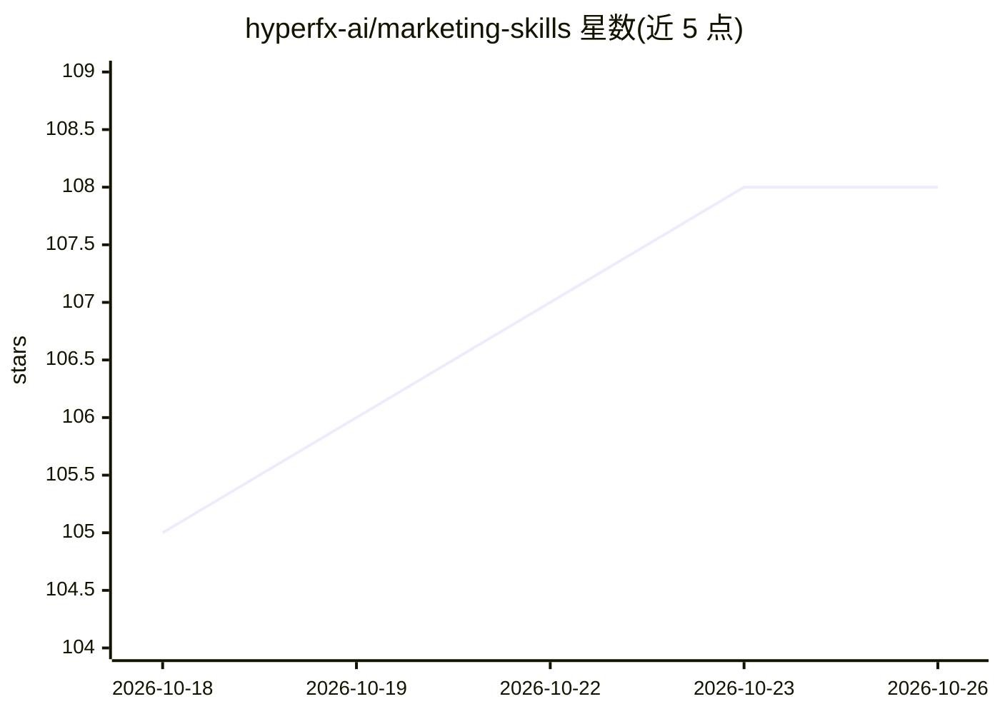

# hyperfx-ai/marketing-skills

⭐ 108 · Python · MIT · 推送 2026-10-24 · [GitHub](https://github.com/hyperfx-ai/marketing-skills) · [官网](https://www.hyperfx.ai/mcp) · 组织维护

**面向 AI agent 的营销技能包（24+ 个 SKILL.md，跑在 Hyper MCP 上）**

以 markdown 技能文件（SKILL.md）形式组织的营销能力集合，覆盖付费广告（Google/Meta/TikTok 等 8+ 平台）、社媒发布、SEO 与竞品研究、广告创意生成、冷邮件与生命周期邮件、GA4 分析等。技能本身教 agent 工作流与决策规则，实际工具由 Hyper MCP 提供（100+ 集成与内置工具），支持 Claude Code、Cursor、Codex、GitHub Copilot 等 50+ 兼容 Agent Skills 规范的客户端。通过 npx skills add 安装，可单装或全装；依赖各技能所需的外部集成（平台账号/API key）。

## 筛选速览

| 维度 | 判定 | 备注 |
|---|---|---|
| AI 角色 | `ai-knowledge` | 知识聚合/清单类 |
| 许可风险 | `permissive` | MIT |
| 部署形态 | `library` | 以包/库形式分发 |
| 模型依赖 | — | README 未给出锁定关系 |
| 硬件要求 | — | 无带数字的原话,不猜 |
| 安装摩擦 | `low` | 无编译、无系统依赖或容器化 |
| 成熟度 | — | 结构信号不足 |

## 能力要点

- 24 个营销技能按付费广告/社媒/研究/创意/外联/分析分类组织
- 工具通过 Hyper MCP 统一端点调用（100+ 集成与内置工具）
- 支持 Claude Code、Cursor、Codex、GitHub Copilot 等 50+ agent 表面
- 每步动作可配置审批规则（guardrails）

## 适用场景

- 让 agent 规划并投放 Google/Meta/TikTok 广告campaign
- 自动生成品牌风格的广告图文与短视频创意
- 挖取 Reddit/YouTube 等渠道做客户与竞品研究
- 从对话中直接驱动 GA4/GTM 报表与转化分析

## 场景标签

`提示工程` · 领域:Agent 开发

## 证据(README 行号)

> L9: A skill is a markdown file (`SKILL.md`) with the workflows, decision rules, and example tool calls your agent needs 
> L5: These skills run on the Hyper MCP, which gives your agent 100+ direct integrations and built-in marketing tools thro

## 星数曲线

2026-10-18 105 → 2026-10-26 108（+3）

---
*卡片 v1 · prompt 1.4 · 生成 2026-10-23 · 置信度 high · 依据 README sha `20a64c78f421` · [字段定义](../../DATASET.md)*
