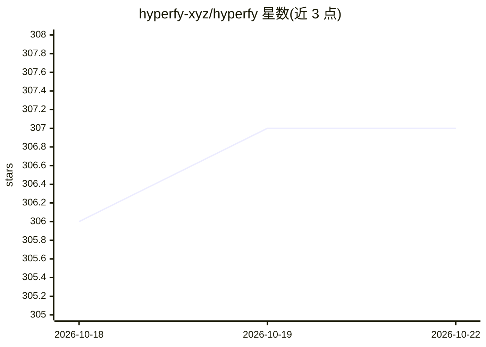

# hyperfy-xyz/hyperfy

⭐ 307 · JavaScript · GPL-3.0 · 推送 2026-04-21 · [GitHub](https://github.com/hyperfy-xyz/hyperfy) · 组织维护

**开发者用开源框架：构建可自托管的多人交互式 3D 虚拟世界**

用于构建交互式 3D 虚拟世界的开源框架：整合 PhysX 物理引擎、网络化实时协作与基于 JavaScript 的组件式应用系统，支持在世界内实时创作、可移植化身、WebXR VR 体验，可自托管于自己的域名或接入 Hyperfy 生态。适用场景包括虚拟活动、产品展厅、社交空间、游戏与教育环境。安装需 Node.js 22.11.0+，通过 git clone 源码运行，另提供 Docker 部署文档；项目处于 alpha 阶段，API 可能变动。

## 筛选速览

| 维度 | 判定 | 备注 |
|---|---|---|
| AI 角色 | `ai-enhanced` | 去掉 AI 部分产品仍成立 |
| 许可风险 | `viral` | GPL-3.0 |
| 部署形态 | `None` |  |
| 模型依赖 | — | README 未给出锁定关系 |
| 硬件要求 | — | 无带数字的原话,不猜 |
| 安装摩擦 | `low` | 无编译、无系统依赖或容器化 |
| 成熟度 | `idea` | |

## 能力要点

- PhysX 物理引擎驱动的交互与实时模拟
- 网络化多人实时协作，可在世界内直接构建内容
- 基于 JavaScript 的组件式应用系统
- 支持 WebXR VR 体验与独立自托管持久世界

## 适用场景

- 在自己的域名上托管多人虚拟活动与会议
- 搭建带空间音频的社交空间或产品展厅
- 开发可 VR 体验的游戏或教育环境

## 场景标签

 · 领域:3D 虚拟世界/游戏引擎

## 证据(README 行号)

> L9: Hyperfy is an open-source framework for building interactive 3D virtual worlds. It combines a powerful physics engin
> L17: - **Physics-based interactions** - Built on PhysX for realistic simulation
> L18: - **WebXR support** - Experience worlds in VR

## 星数曲线

2026-10-18 306 → 2026-10-22 307（+1）

---
*卡片 v1 · prompt 1.4 · 生成 2026-10-21 · 置信度 low · 依据 README sha `47e33c2e0099` · [字段定义](../../DATASET.md)*
