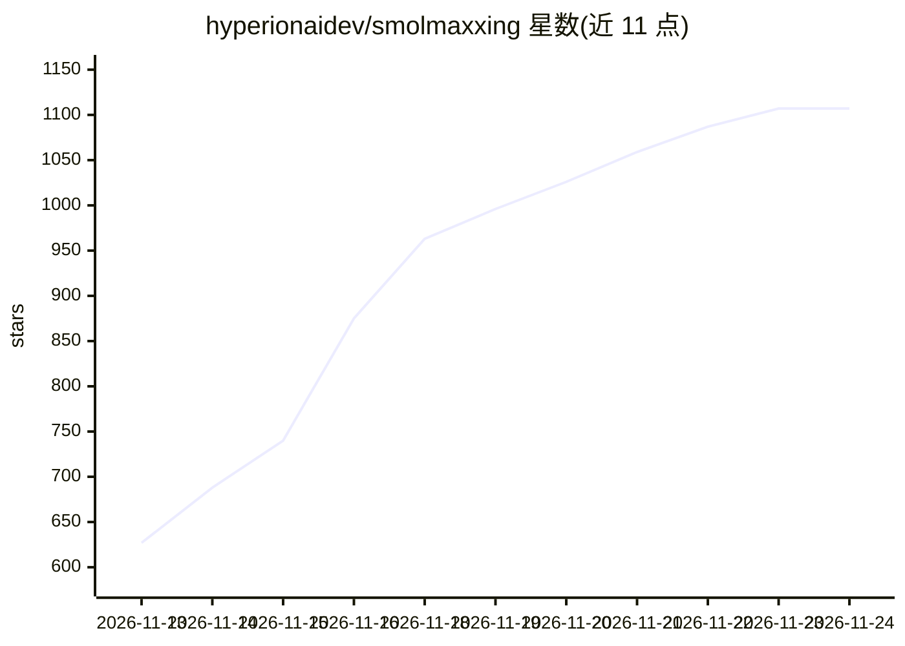

# hyperionaidev/smolmaxxing

⭐ 1,107 · C · MIT · 推送 2026-11-19 · [GitHub](https://github.com/hyperionaidev/smolmaxxing) · [官网](https://hyperion-ai.com/products/smolmaxxing) · 组织维护

**在电视盒/旧手机/Kindle 等小设备上运行大语言模型的 llama.cpp 补丁集**

smolmaxxing 通过给 llama.cpp 打补丁，在电视盒、旧手机、iPad、Kindle 等闲置小设备上运行尽可能大的语言模型。关键机制包括：针对 Cortex-A55、Apple A7 等芯片的 1-bit/2-bit/ternary 查找表内核，裁剪低频词表输出行以省 RAM，MoE 专家按需从闪存分页与预取，以及稠密模型的闪存流式读取。README 给出 6 台实测设备的量化结果（260K 到 80B 参数），提供各设备安装文档、模型重建工具、聊天界面与完整实验记录。限制：TV 盒与 iPad 模型文件需要补丁版 llama.cpp 方能加载。

## 筛选速览

| 维度 | 判定 | 备注 |
|---|---|---|
| AI 角色 | `ai-ecosystem` | LLM/agent 周边工具 |
| 许可风险 | `permissive` | MIT |
| 部署形态 | `None` |  |
| 模型依赖 | local-ok | 支持本地模型 |
| 硬件要求 | — | 无带数字的原话,不猜 |
| 安装摩擦 | `low` | 无编译、无系统依赖或容器化 |
| 成熟度 | — | 结构信号不足 |

## 能力要点

- 针对 Cortex-A55 与 Apple A7 的 1-bit 查找表内核与 2-bit/ternary 重排格式
- MoE 专家从闪存分页与预取，8B/16B 模型跑在约 1 GB RAM 设备上
- 低频词表裁剪与 headless 模式降低内存占用
- 6 台实测设备数据、171 次实验记录与全部补丁开源

## 适用场景

- 在电视盒或旧安卓手机上本地运行聊天/编码助手
- 为无 dotprod 或 32 位 ARM 设备搭建可用的 LLM 推理
- 贡献小设备实测数据加入社区结果表

## 场景标签

`推理引擎` `模型量化` · 领域:训练与推理

## 证据(README 行号)

> L37: All of it is a patch on llama.cpp. The main ideas:
> L8: **Run the biggest language model you can on the smallest hardware you own.**

## 星数曲线

2026-11-13 627 → 2026-11-24 1,107（+480）

---
*卡片 v1 · prompt 1.4 · 生成 2026-11-24 · 置信度 high · 依据 README sha `4f89dcb74531` · [字段定义](../../DATASET.md)*
