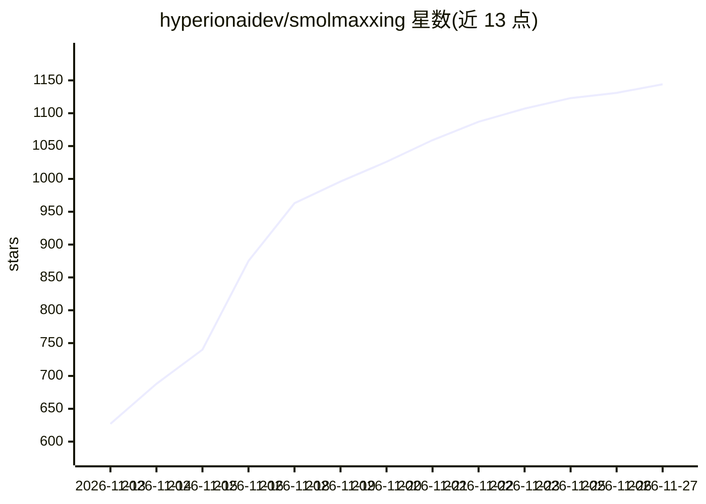

# hyperionaidev/smolmaxxing

⭐ 1,144 · C · MIT · 推送 2026-11-25 · [GitHub](https://github.com/hyperionaidev/smolmaxxing) · [官网](https://hyperion-ai.com/products/smolmaxxing) · 个人维护

**给极小硬件（电视盒/旧手机/Kindle）跑大 LLM 的 llama.cpp 补丁与实测**

对 llama.cpp 打补丁的项目：为 Cortex-A55、Apple A7 等 CPU 定制 1-bit/2-bit/三元权重内核，砍掉低频词表行降内存，用专家按需换页（MoE）与稠密模型 flash 流式读取，使 1 GB RAM 设备跑 8B/16B、3 GB 余量手机跑 35B/80B 模型。已在 8 台真实设备上测速并附吞吐数据，提供 Hugging Face 模型文件、各设备 setup 文档、离线聊天 App 与基准结果。模型文件需配套补丁版 llama.cpp 加载。

## 筛选速览

| 维度 | 判定 | 备注 |
|---|---|---|
| AI 角色 | `ai-ecosystem` | LLM/agent 周边工具 |
| 许可风险 | `permissive` | MIT |
| 部署形态 | `None` |  |
| 模型依赖 | local-ok | 支持本地模型 |
| 硬件要求 | — | 无带数字的原话,不猜 |
| 安装摩擦 | `low` | 无编译、无系统依赖或容器化 |
| 成熟度 | — | 结构信号不足 |

## 能力要点

- 1-bit 查表内核只需基础 NEON，无 dotprod 的 A7/A76 也有对应构建
- MoE 专家换页与稠密模型 flash 流式读取，模型可大于 RAM
- 8 台设备实测吞吐数据与 171 次实验的完整记录（EXPERIMENT.md）
- 提供 SmolChat 离线聊天 App，开机自启模型服务

## 适用场景

- 在电视盒、旧手机、单板机上离线运行本地 LLM
- 为低内存 ARM 设备复现或提交实测吞吐数据
- 查找小内存设备可运行的量化模型文件与重建方法

## 场景标签

`推理引擎` `模型量化` `聊天机器人` · 领域:对话与助手

## 证据(README 行号)

> L80: All of it is a patch on llama.cpp. The main ideas:
> L91: The quickest start is a ready-made model file from Hugging Face. The TV box and iPad files need the patched llama.c

## 星数曲线

2026-11-13 627 → 2026-11-27 1,144（+517）

---
*卡片 v1 · prompt 1.4 · 生成 2026-11-25 · 置信度 mid · 依据 README sha `1f453c328af4` · [字段定义](../../DATASET.md)*
