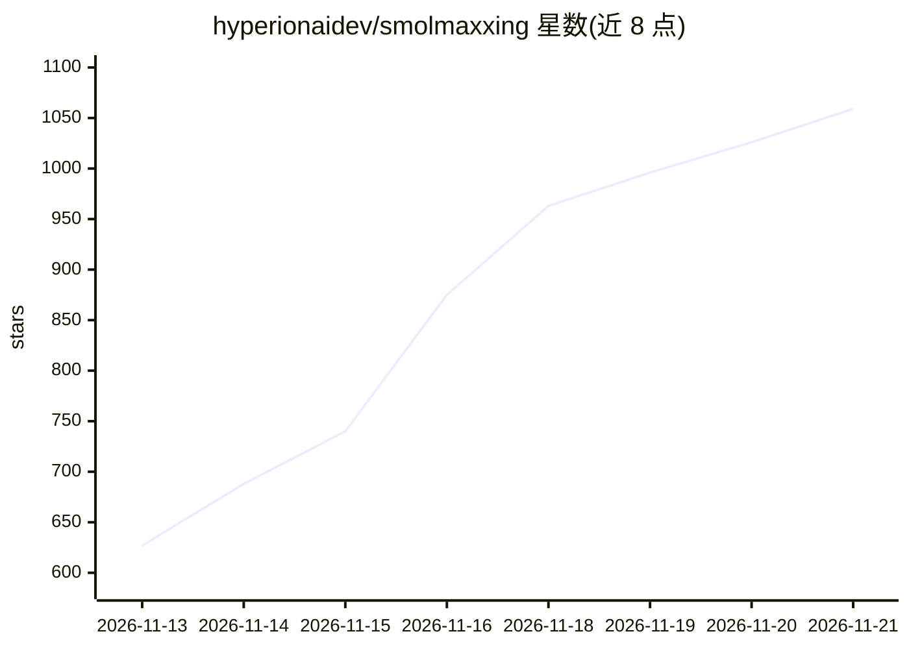

# hyperionaidev/smolmaxxing

⭐ 1,059 · C · MIT · 推送 2026-11-19 · [GitHub](https://github.com/hyperionaidev/smolmaxxing) · [官网](https://hyperion-ai.com/products/smolmaxxing) · 个人维护

**让旧手机、电视盒等低配设备跑大模型的 llama.cpp 补丁集**

以 llama.cpp 补丁形式提供的技术集合与实测记录：面向电视盒、2013 年 iPad、安卓手机三类设备，通过为芯片定制的 1-bit/2-bit/三值内核、裁剪输出层、专家分页与 flash 流式加载，把 8B-80B 模型装进 1-3GB 可用内存。仓库含设备实测数据、165 次实验记录、模型重建工具与各设备搭建文档，欢迎社区提交更多设备的测试数据。

## 筛选速览

| 维度 | 判定 | 备注 |
|---|---|---|
| AI 角色 | `ai-ecosystem` | LLM/agent 周边工具 |
| 许可风险 | `permissive` | MIT |
| 部署形态 | `None` |  |
| 模型依赖 | local-ok | 支持本地模型 |
| 硬件要求 | — | 无带数字的原话,不猜 |
| 安装摩擦 | `low` | 无编译、无系统依赖或容器化 |
| 成熟度 | — | 结构信号不足 |

## 能力要点

- 针对 Cortex-A55/Apple A7 的定制 1-bit 与重排 2-bit/三值内核
- MoE 专家从 flash 按需分页加载，1GB 内存跑 8B/16B 模型
- 三台设备的逐项实测速度与 165 次实验的完整实验记录
- 提供 Hugging Face 现成模型文件与各设备搭建文档

## 适用场景

- 在闲置电视盒、旧手机上运行本地 LLM
- 研究小内存设备的量化与 flash 流式推理技术
- 查看不同低配设备上各规模模型的实测速度做选型参考

## 场景标签

`推理引擎` `模型量化` · 领域:训练与推理

## 证据(README 行号)

> L37: All of it is a patch on llama.cpp. The main ideas:
> L41: - **Experts paged from flash.** A mixture-of-experts model only uses a few experts per token. We keep the popular o

## 星数曲线

2026-11-13 627 → 2026-11-21 1,059（+432）

---
*卡片 v1 · prompt 1.4 · 生成 2026-11-17 · 置信度 high · 依据 README sha `c174146d916d` · [字段定义](../../DATASET.md)*
