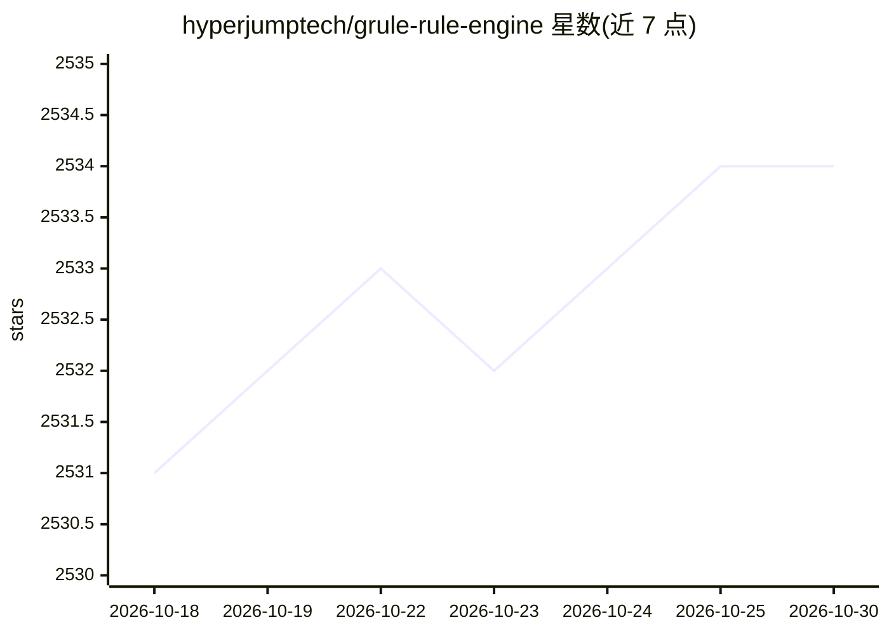

# hyperjumptech/grule-rule-engine

⭐ 2,534 · Go · NOASSERTION · 推送 2026-02-10 · [GitHub](https://github.com/hyperjumptech/grule-rule-engine) · 组织维护

**Go 语言的规则引擎库：以 DSL 声明业务规则并执行推理**

Grule 是用 Go 编写的规则引擎库，受 JBOSS Drools 启发但更简化。提供自有 DSL（GRL），以 when/then 结构声明规则；基于产生式规则系统与推理引擎，将事实数据与规则匹配并触发动作。以 Go 包形式集成（go get），规则即数据可动态调整而无需重新编译部署。README 给出规则加载与事实执行的性能基准数据，并列出专家系统、评分、游戏规则、分类、建议系统等用例。

## 筛选速览

| 维度 | 判定 | 备注 |
|---|---|---|
| AI 角色 | `ai-native` | 本体是模型或模型工具 |
| 许可风险 | `none` | NOASSERTION |
| 部署形态 | `None` |  |
| 模型依赖 | — | README 未给出锁定关系 |
| 硬件要求 | — | 无带数字的原话,不猜 |
| 安装摩擦 | `low` | 无编译、无系统依赖或容器化 |
| 成熟度 | — | 结构信号不足 |

## 能力要点

- 自有 DSL（GRL）以 when/then 结构声明规则
- 产生式规则系统与推理引擎，匹配事实并执行动作
- 以 Go 库形式集成，规则作为数据可动态更新
- README 提供规则加载与执行的基准数据

## 适用场景

- 把业务逻辑从代码中分离，交给业务人员维护规则
- 银行客户评分、信贷资格与保险风险评估等分类系统
- 游戏中玩家状态、奖励与伤害等规则的处理

## 场景标签

 · 领域:软件开发/业务规则引擎

## 证据(README 行号)

> L17: **Grule** is a Rule Engine library for the Go (Golang) programming language. Inspired by the acclaimed JBOSS Drools
> L45: The **Grule** Rule Engine is a Production Rule System that uses the rule-based approach to implement an Expert Syst
> L49: The brain of a Production Rules System is an *Inference Engine* that can scale to a large number of rules and facts

## 星数曲线

2026-10-18 2,531 → 2026-10-30 2,534（+3）

---
*卡片 v1 · prompt 1.4 · 生成 2026-10-21 · 置信度 mid · 依据 README sha `a4ac6cedc26d` · [字段定义](../../DATASET.md)*
