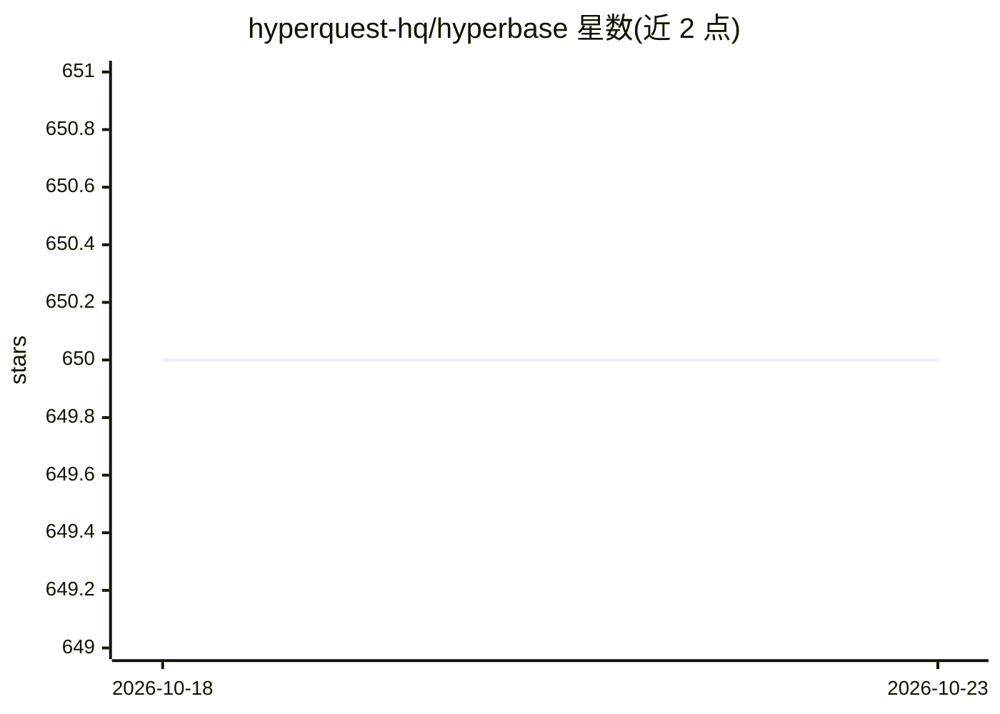

# hyperquest-hq/hyperbase

⭐ 650 · Python · MIT · 推送 2026-10-18 · [GitHub](https://github.com/hyperquest-hq/hyperbase) · [官网](https://hyperquest.ai/hyperbase) · 组织维护

**语义超图基础库：将自然语言句子表示为有序递归超链接**

Python 编写的基础库，用于构建和处理语义超图（Semantic Hypergraphs）：可将自然语言句子表示为有序、递归的超链接结构，服务自然语言理解与知识表示研究。项目由 CNRS 与 ERC Consolidator Grant Socsemics (#772743) 资助，采用 MIT 许可证。README 本身不包含 API 用法或安装命令，安装说明与手册托管在外部站点 hyperquest.ai/hyperbase。

## 筛选速览

| 维度 | 判定 | 备注 |
|---|---|---|
| AI 角色 | `ai-native` | 本体是模型或模型工具 |
| 许可风险 | `permissive` | MIT |
| 部署形态 | `None` |  |
| 模型依赖 | — | README 未给出锁定关系 |
| 硬件要求 | — | 无带数字的原话,不猜 |
| 安装摩擦 | `low` | 无编译、无系统依赖或容器化 |
| 成熟度 | — | 结构信号不足 |

## 能力要点

- 将自然语言句子表示为有序、递归的超链接结构
- Python 实现，便于与科学计算库集成
- CNRS 与 ERC 资助的研究产出，MIT 许可

## 适用场景

- 自然语言理解研究中的句子语义结构表示
- 知识图谱/知识表示研究构建超图数据
- 计算社会科学中的语义建模

## 场景标签

`知识图谱` · 领域:知识与检索

## 证据(README 行号)

> L3: ## A foundational library for Semantic Hypergraphs
> L5: Hyperbase is a foundational library for working with *Semantic Hypergraphs (SH)*, which make it possible to represen
> L21: The creation of this software library and the associated research that made it possible were funded by CNRS and the

## 星数曲线

2026-10-18 650 → 2026-10-23 650（+0）

---
*卡片 v1 · prompt 1.4 · 生成 2026-10-21 · 置信度 mid · 依据 README sha `9038af5e22d0` · [字段定义](../../DATASET.md)*
