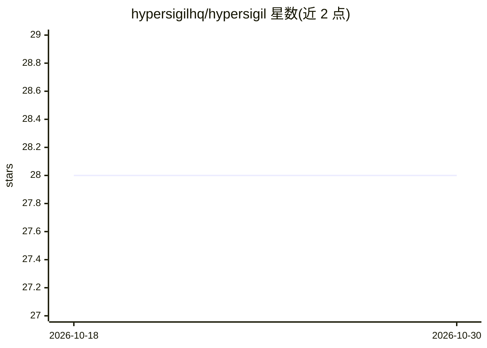

# hypersigilhq/hypersigil

⭐ 28 · Vue · NOASSERTION · 推送 2026-04-17 · [GitHub](https://github.com/hypersigilhq/hypersigil) · [官网](https://hypersigilhq.github.io/hypersigil/introduction/) · 组织维护

**带 UI 的多供应商提示词管理网关，面向技术与非技术用户**

AI 提示词管理平台：集中管理提示词、版本跟踪、Mustache 模板变量，通过 API 热切换提示词而无需重新部署代码；支持跨 Ollama、OpenAI、Anthropic 等供应商执行提示词，提供成本优化、自动故障转移与健康监测。面向组织内技术与非技术用户协作：角色权限、评论、测试数据分组批量执行、基于执行结果的 AI 校准。Node.js/TypeScript 后端（Express、SQLite）+ Vue 3 前端，以 Docker 镜像或源码方式运行，项目声明处于重度开发中。

## 筛选速览

| 维度 | 判定 | 备注 |
|---|---|---|
| AI 角色 | `ai-ecosystem` | LLM/agent 周边工具 |
| 许可风险 | `none` | NOASSERTION |
| 部署形态 | `self-host` | docker 或自建部署 |
| 模型依赖 | local-ok | 支持本地模型 |
| 硬件要求 | — | 无带数字的原话,不猜 |
| 安装摩擦 | `low` | 无编译、无系统依赖或容器化 |
| 成熟度 | `idea` | |

## 能力要点

- 提示词热切换：通过 API 换提示词无需代码重部署
- 多供应商网关：Ollama/OpenAI/Anthropic 执行、自动故障转移
- 测试数据分组批量执行与结果对比（csv/markdown/json 导入）
- 角色权限、邀请制、审计记录与 API Key 集中管理

## 适用场景

- 团队集中管理提示词并让领域专家参与测试与评论
- 跨多个 AI 供应商测试并比较同一提示词的表现
- 生产环境热切换提示词并保留完整审计记录

## 场景标签

`模型网关` `提示工程` · 领域:Agent 开发

## 证据(README 行号)

> L7: **Hypersigil** is an AI prompt management platform that enables organizations to centralize, optimize, and dynamical
> L32: - **Multi-Provider AI Gateway**: Test and compare prompts across OpenAI, Anthropic, Ollama (more providers soon) wi
> L48: - **Multi-Provider Support**: Execute prompts across Ollama, OpenAI, Anthropic, and other AI providers

## 星数曲线

2026-10-18 28 → 2026-10-30 28（+0）

---
*卡片 v1 · prompt 1.4 · 生成 2026-10-26 · 置信度 mid · 依据 README sha `7f0a0e59c689` · [字段定义](../../DATASET.md)*
