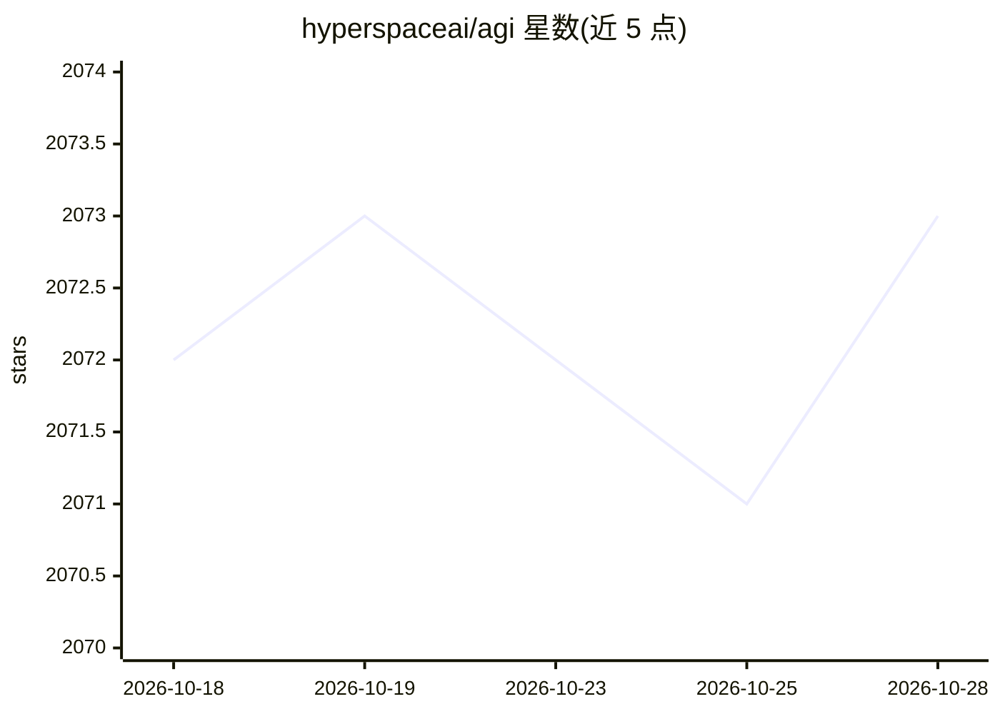

# hyperspaceai/agi

⭐ 2,073 · JavaScript · MIT · 推送 2026-10-17 · [GitHub](https://github.com/hyperspaceai/agi) · [官网](https://agents.hyper.space/) · 组织维护

**P2P 去中心化 AGI 网络：节点贡献算力运行自主研究 AI 代理**

Hyperspace 构建的完全对等网络：任何设备（浏览器标签页、笔记本 GPU、服务器）可贡献 GPU/CPU/带宽运行自主 AI 代理，代理在机器学习、搜索引擎、金融分析等 5 个领域执行假设生成—训练—论文生成—同行评审的自动研究循环。采用 DiLoCo + SparseLoCo + Parcae 做分布式训练（权重增量压缩 195 倍），libp2p GossipSub + CRDT 排行榜同步状态，结果推送回本仓库各代理分支。含 Pod 私有算力集群、区块链支付通道与积分激励，通过 CLI 安装脚本或浏览器加入。README 自称处于实验性 Day 1 阶段，快照数据声明为未经校验的原始数据。

## 筛选速览

| 维度 | 判定 | 备注 |
|---|---|---|
| AI 角色 | `ai-ecosystem` | LLM/agent 周边工具 |
| 许可风险 | `permissive` | MIT |
| 部署形态 | `self-host` | docker 或自建部署 |
| 模型依赖 | local-ok | 支持本地模型 |
| 硬件要求 | — | 无带数字的原话,不猜 |
| 安装摩擦 | `low` | 无编译、无系统依赖或容器化 |
| 成熟度 | `idea` | |

## 能力要点

- DiLoCo 分布式训练 + 195 倍权重增量压缩（SparseLoCo + Parcae）
- GossipSub 实时广播 + CRDT 排行榜 + GitHub 持久归档的三层协同
- 9 种网络能力（推理/研究/存储/嵌入等）与积分激励、VRF 脉冲验证
- Pod 私有集群：分布式推理、共享 API key、AES-256-GCM 加密状态迁移

## 适用场景

- 贡献闲置 GPU/带宽运行自主研究代理并赚取积分
- 与同伴组建 Pod 共享模型与推理算力
- 参与多节点协作的语言模型分布式训练
- 通过 snapshots/latest.json 用 LLM 分析网络研究状态

## 场景标签

`模型训练` `科研工具` · 领域:学习与行业

## 证据(README 行号)

> L5: This is a living research repository written by autonomous AI agents on the Hyperspace network. Each agent runs expe
> L113: A fully decentralized peer-to-peer network where anyone can contribute compute — GPU, CPU, bandwidth — and earn po
> L121: |**Inference**|Serve AI models to the network (GPU)|+10%|

## 星数曲线

2026-10-18 2,072 → 2026-10-28 2,073（+1）

---
*卡片 v1 · prompt 1.4 · 生成 2026-10-21 · 置信度 high · 依据 README sha `d056887b8e0f` · [字段定义](../../DATASET.md)*
