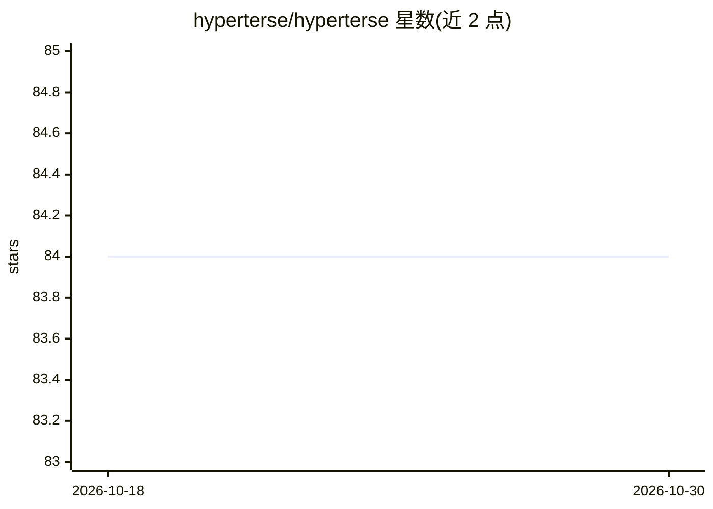

# hyperterse/hyperterse

⭐ 84 · Go · Apache-2.0 · 推送 2026-04-22 · [GitHub](https://github.com/hyperterse/hyperterse) · [官网](https://hyperterse.com) · 组织维护

**一体化 agentic 服务框架：单进程交付 MCP 工具与 A2A agent**

TypeScript/声明式配置的服务器框架：在同一构建与单一进程中交付 MCP 工具（Streamable HTTP /mcp，实现 MCP 规范 2025-11-25）、A2A 风格 agent 路由（/agent/{name}）、prompt 模板、资源、数据库适配器（PostgreSQL/MySQL/SQLite/MongoDB/Redis）、按工具粒度鉴权、内存缓存与 OpenTelemetry 可观测性。工具支持 DB 语句或脚本 handler 两种执行模式，配 CLI（init/start/validate/build/serve）。文本结果支持完整，image/audio/resource_link 与分页为可选项。

## 筛选速览

| 维度 | 判定 | 备注 |
|---|---|---|
| AI 角色 | `ai-ecosystem` | LLM/agent 周边工具 |
| 许可风险 | `permissive` | Apache-2.0 |
| 部署形态 | `None` |  |
| 模型依赖 | — | README 未给出锁定关系 |
| 硬件要求 | — | 无带数字的原话,不猜 |
| 安装摩擦 | `low` | 无编译、无系统依赖或容器化 |
| 成熟度 | — | 结构信号不足 |

## 能力要点

- 单进程同时暴露 MCP（Streamable HTTP）与 A2A agent 路由
- 声明式配置编译验证，工具支持 DB 语句或 TS handler 双模式
- 内置 5 种数据库适配器、按工具鉴权、缓存与 OpenTelemetry
- 遵循 MCP 规范 2025-11-25，提供 CLI 脚手架与构建流程

## 适用场景

- 把数据库查询与自定义逻辑封装为 MCP 工具对外提供
- 在单一可部署服务中同时运行 agent 与 MCP 工具/提示/资源
- 为生产环境 MCP 服务配置鉴权、缓存与链路追踪

## 场景标签

`Agent 框架` · 领域:Agent 开发

## 证据(README 行号)

> L16: **Hyperterse** is an **agentic server framework**: one build ships **agents** (A2A), **tools** (MCP), **prompts**, 
> L29: - Running **agents** alongside **MCP tools**, **prompts**, and **resources** in one deployable service
> L31: - Production **Streamable HTTP** for MCP and **A2A** routes for agents

## 星数曲线

2026-10-18 84 → 2026-10-30 84（+0）

---
*卡片 v1 · prompt 1.4 · 生成 2026-10-24 · 置信度 high · 依据 README sha `84b7f0afd5fb` · [字段定义](../../DATASET.md)*
