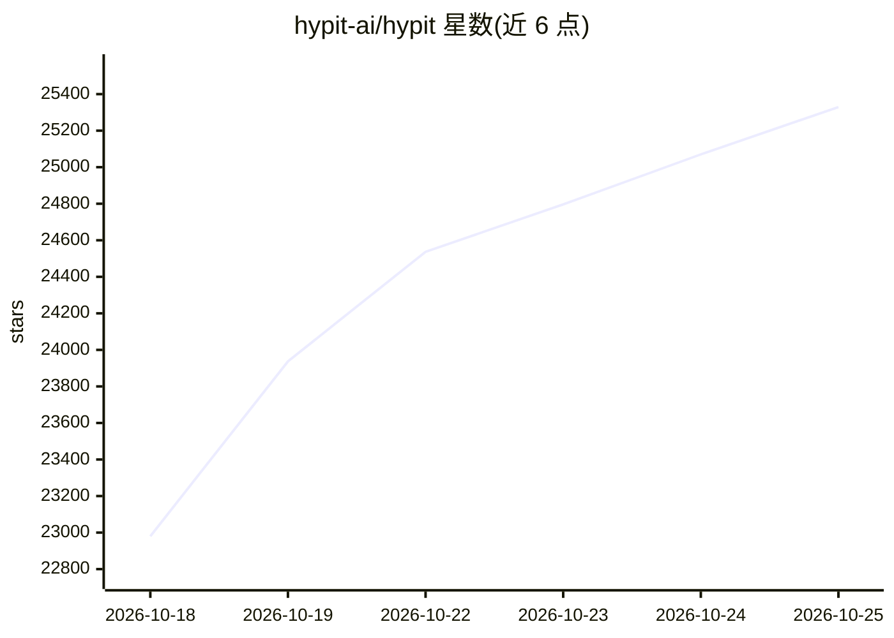

# hypit-ai/hypit

⭐ 25,580 · TypeScript · NOASSERTION · 推送 2026-10-24 · [GitHub](https://github.com/hypit-ai/hypit) · [官网](https://hypit.ai) · 组织维护 · 中文 README

**给编码 Agent 用的视频克隆工作流 DSL 与技能：一条命令产出多版本视频**

Hypit 以 Skill 形式安装（npx skills add），为 Claude Code、Codex 等编码 Agent 提供 SVML 标记语言和组件系统来制作视频：放入参考视频后 Agent 将其克隆为完整工作流（素材、字幕、B-roll、特效），时间轴锚定到词而非秒；也可从模板起步或由 Agent 从零编写。工作流编译为成品视频，可通过无头 Chromium 进程并发渲染，生成模型为可选项（纯代码渲染可不调用生成 API）。开源无席位费、单次渲染费或水印，模型服务按所选服务商计费。

## 筛选速览

| 维度 | 判定 | 备注 |
|---|---|---|
| AI 角色 | `ai-native` | 本体是模型或模型工具 |
| 许可风险 | `none` | NOASSERTION |
| 部署形态 | `library` | 以包/库形式分发 |
| 模型依赖 | — | README 未给出锁定关系 |
| 硬件要求 | — | 无带数字的原话,不猜 |
| 安装摩擦 | `low` | 无编译、无系统依赖或容器化 |
| 成熟度 | — | 结构信号不足 |

## 动量与使用信号

- 维护:`active` — 距上次 push 3.0 天,年发版 27,22 位贡献者
- 涨星:近 1 天 **+322**(自 20261016 起算)
- 安装:npm 包 `skills` 月下载 23,786,800
- 平台:— · 协议:MCP

## 能力要点

- 视频克隆为可编辑、可重跑的完整工作流（SVML 语言 + 插件组件系统）
- 一个工作流批量生成变体：换主持人、换文案、换语言，一处结构多处复用
- 支持无生成模型的纯代码渲染路径（字幕、动效、代码视觉本地渲染）
- npx skills add 一条命令安装到编码 Agent

## 适用场景

- 克隆爆款短视频并批量替换产品、主持人或语言做投放变体
- 为 TikTok Shop/联盟带货每天用同一格式产出不同 SKU 视频
- 做十种语言的本地化版本，改一行台词时间轴自动重排
- 不调生成 API，用前端代码纯本地渲染视频

## 场景标签

`视频生成` `工作流自动化` · 领域:效率与自动化

## 证据(README 行号)

> L34: Hypit gives AI agents (Claude Code, Codex...) a language and system to create video. Drop in a video, and your agen
> L36: **To be clear:** cloning a video is the fastest way in, not the only one. You can start from our templates, or just
> L45: npx skills add hypit-ai/hypit -g

## 星数曲线

2026-10-18 22,980 → 2026-10-25 25,329（+2,349）

---
*卡片 v1 · prompt 1.4 · 生成 2026-10-18 · 置信度 high · 依据 README sha `7d4a45d4e005` · [字段定义](../../DATASET.md)*
