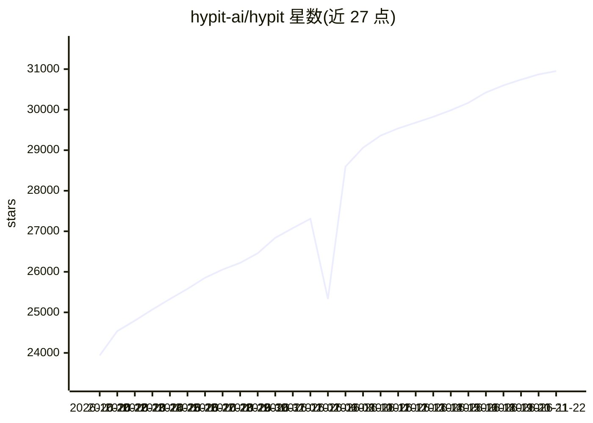

# hypit-ai/hypit

⭐ 30,952 · TypeScript · NOASSERTION · 推送 2026-11-20 · [GitHub](https://github.com/hypit-ai/hypit) · [官网](https://hypit.ai) · 组织维护 · 中文 README

**让编程 Agent 用 SVML 语言批量克隆/生成短视频的工作流系统**

Hypit 为编程 Agent（如 Claude Code、Codex）提供一套视频创作语言与系统：输入参考视频后，Agent 将其克隆为完整工作流（素材、字幕、B-roll、特效），以词为时间锚点而非秒数。也可从模板或文字描述从头生成。工作流可复用并批量产出变体；生成模型可选，纯代码渲染路径无需调用生成 API。通过 npx 安装 Skill，本地以无头 Chromium 并发渲染成片。

## 筛选速览

| 维度 | 判定 | 备注 |
|---|---|---|
| AI 角色 | `ai-native` | 本体是模型或模型工具 |
| 许可风险 | `none` | NOASSERTION |
| 部署形态 | `library` | 以包/库形式分发 |
| 模型依赖 | — | README 未给出锁定关系 |
| 硬件要求 | — | 无带数字的原话,不猜 |
| 安装摩擦 | `low` | 无编译、无系统依赖或容器化 |
| 成熟度 | — | 结构信号不足 |

## 动量与使用信号

- 维护:`active` — 距上次 push 3.0 天,年发版 27,22 位贡献者
- 涨星:近 1 天 **+322**(自 20261016 起算)
- 安装:npm 包 `skills` 月下载 23,786,800
- 平台:— · 协议:MCP

## 能力要点

- 视频被克隆为可编辑、可重跑的完整工作流而非一次性渲染
- 同一工作流可批量产出 100 个变体（换角色/产品/语言/比例）
- 生成模型可选：纯代码渲染路径不调用生成 API
- 插件化组件可替换（如换主持人不动字幕），npm 发布共享

## 适用场景

- 把爆款 TikTok/Reels 克隆成模板并批量换装变体
- 为电商和联盟营销每日产出同格式不同 SKU 的短视频
- 同一视频批量本地化为十种语言
- 不调用生成 API、纯前端代码渲染视频

## 场景标签

`工作流自动化` `视频生成` · 领域:效率与自动化

## 证据(README 行号)

> L34: Hypit gives AI agents (Claude Code, Codex...) a language and system to create video. Drop in a video, and your agen
> L36: **To be clear:** cloning a video is the fastest way in, not the only one. You can start from our templates, or just

## 星数曲线

2026-10-20 23,937 → 2026-11-22 30,952（+7,015）

---
*卡片 v1 · prompt 1.4 · 生成 2026-11-22 · 置信度 high · 依据 README sha `6504d1af9282` · [字段定义](../../DATASET.md)*
