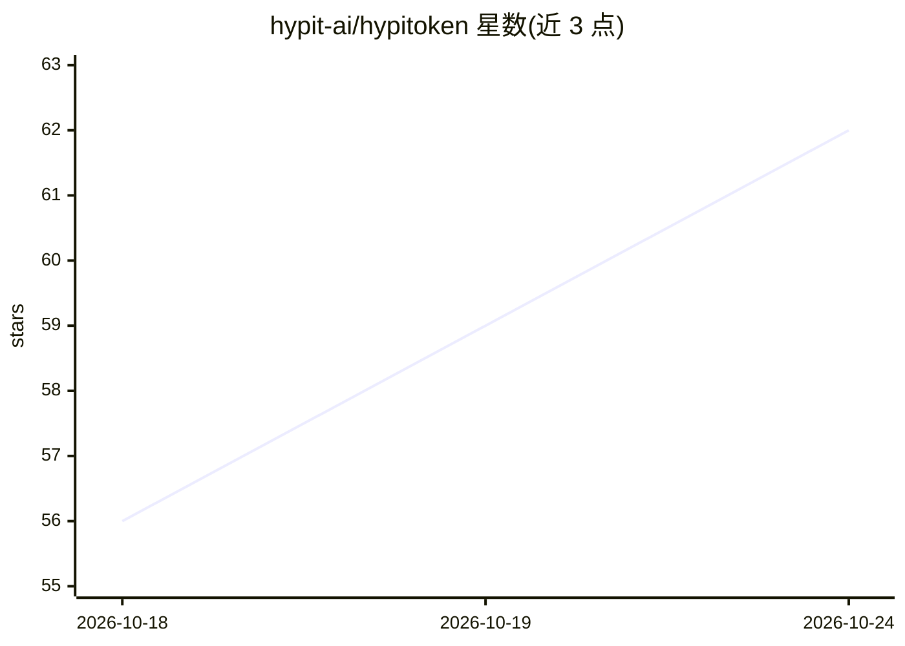

# hypit-ai/hypitoken

⭐ 62 · Go · NOASSERTION · 推送 2026-10-13 · [GitHub](https://github.com/hypit-ai/hypitoken) · [官网](https://github.com/cashdiffusion/hypitoken) · 组织维护 · 中文 README

**自托管多租户 LLM API 网关：Claude/Codex 凭据池与美元钱包计费**

单静态 Go 二进制的自托管 LLM 网关，将客户端请求分发到多个上游凭据（Anthropic OAuth/API key、OpenAI/ChatGPT OAuth/API key），提供粘性会话、凭据轮换、按凭据代理与 JSONL 请求日志。商业 SaaS 层提供邮箱注册、美元钱包（支付宝按实时汇率充值）、按用户 API token 的日/月美元上限、定价组、状态页与运营面板。计费按官方成本×汇率锚定×组倍率，钱包账本 append-only，SQLite 迁移前自动备份。需要自行部署并配置支付宝商户、SMTP 与 HTTPS。

## 筛选速览

| 维度 | 判定 | 备注 |
|---|---|---|
| AI 角色 | `ai-ecosystem` | LLM/agent 周边工具 |
| 许可风险 | `none` | NOASSERTION |
| 部署形态 | `None` |  |
| 模型依赖 | locked-api |  |
| 硬件要求 | — | 无带数字的原话,不猜 |
| 安装摩擦 | `low` | 无编译、无系统依赖或容器化 |
| 成熟度 | — | 结构信号不足 |

## 能力要点

- 凭据池 + 粘性会话 + 429/5xx 自动轮换重试
- 美元钱包与支付宝充值，按官方成本×汇率锚定计费
- 每 token 日/月美元上限、并发与 RPM 限制
- 状态页每 30 分钟按模型探测，运营面板管理用户/凭据/支付

## 适用场景

- 团队共用订阅凭据对外提供 API 转售服务
- 自建 Claude/Codex 代理并按用量向成员计费
- 需要状态页与运营面板的自托管 LLM 接入层

## 场景标签

`模型网关` · 领域:Agent 开发

## 证据(README 行号)

> L9: HypiToken is a self-hostable LLM gateway that fans out client requests across many upstream credentials (Anthropic O
> L11: It started life as a reverse proxy for personal credential pooling. The commercial SaaS layer adds per-user account

## 星数曲线

2026-10-18 56 → 2026-10-24 62（+6）

---
*卡片 v1 · prompt 1.4 · 生成 2026-10-24 · 置信度 high · 依据 README sha `013bc9fc2064` · [字段定义](../../DATASET.md)*
