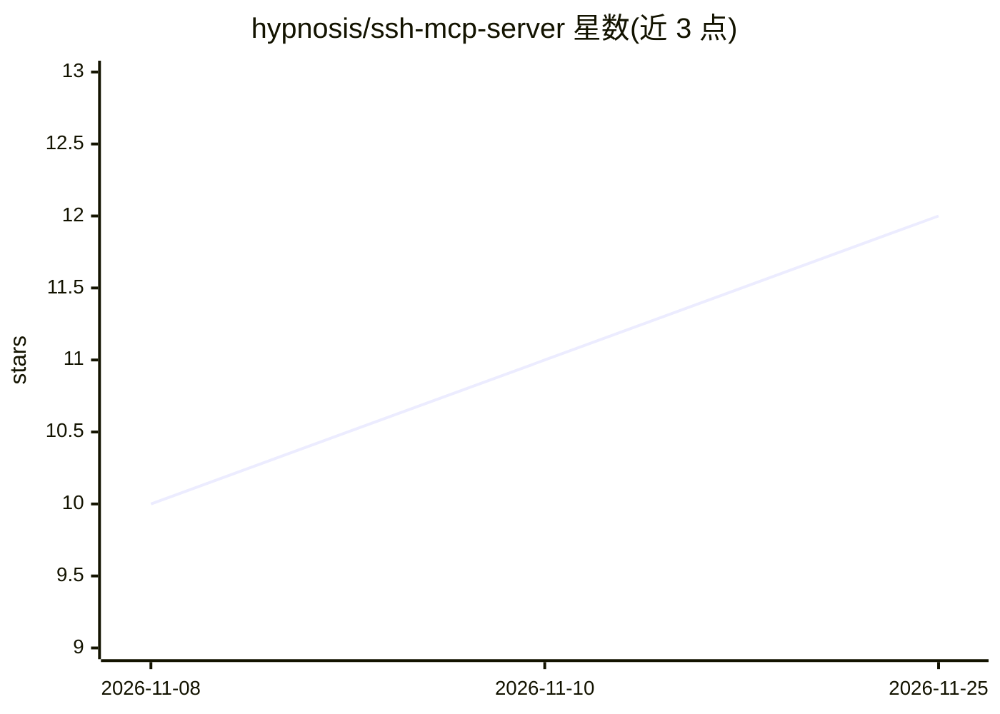

# hypnosis/ssh-mcp-server

⭐ 12 · TypeScript · MIT · 推送 2026-11-13 · [GitHub](https://github.com/hypnosis/ssh-mcp-server) · [官网](https://www.npmjs.com/package/@hypnosis/ssh-mcp-server) · 个人维护

**给 AI agent 提供远程 SSH 运维工具的 MCP 服务器**

基于 Model Context Protocol 的 SSH 服务器，通过系统已有的 OpenSSH 客户端为 AI agent 提供远程命令执行、文件读写与传输、日志搜索、服务器基线审计等结构化工具。复用用户的密钥、~/.ssh/config 与跳板机配置，无内置 SSH 实现、无需编译、无原生绑定；对旧协议设备与缺失工具自动回退，未测量的项显式标注而非读作零。面向 DevOps/SRE、自运维 VPS 的开发者与 Homelab 用户，通过 npx 运行或装为 Claude Code 插件。

## 筛选速览

| 维度 | 判定 | 备注 |
|---|---|---|
| AI 角色 | `ai-ecosystem` | LLM/agent 周边工具 |
| 许可风险 | `permissive` | MIT |
| 部署形态 | `self-host` | docker 或自建部署 |
| 模型依赖 | — | README 未给出锁定关系 |
| 硬件要求 | — | 无带数字的原话,不猜 |
| 安装摩擦 | `low` | 无编译、无系统依赖或容器化 |
| 成熟度 | — | 结构信号不足 |

## 能力要点

- 复用系统 OpenSSH：密钥、~/.ssh/config、跳板机、agent forwarding 均保持原样
- 结构化输出标注 truncated/unavailable/files_unreadable，区分未测量与空结果
- 对旧 scp 协议的路由器/NAS 自动回退并记忆设备
- ssh_audit_baseline 一次批量收集系统、磁盘、内存、端口、sshd、Docker、防火墙等状态

## 适用场景

- 让 Claude Code/Codex 等 agent 通过 SSH 排查生产服务器故障
- 向老旧路由器、NAS 传输文件而无需手工换协议参数
- 用结构化审计工具替代给 agent 开放原始 shell
- 部署前批量预检 nginx 配置、服务状态与日志

## 场景标签

 · 领域:开发者工具/DevOps

## 证据(README 行号)

> L1: # SSH MCP Server — Remote server tools for AI agents
> L5:  An SSH MCP server — a multitool that saves you and your AI agent time and tokens on debugging, development and serv
> L10: Works with Claude Code, Codex CLI, Cline, opencode, Gemini CLI, Qwen Code, Hermes and other MCP clients.

## 星数曲线

2026-11-08 10 → 2026-11-25 12（+2）

---
*卡片 v1 · prompt 1.4 · 生成 2026-11-18 · 置信度 mid · 依据 README sha `75891e7e6ee3` · [字段定义](../../DATASET.md)*
