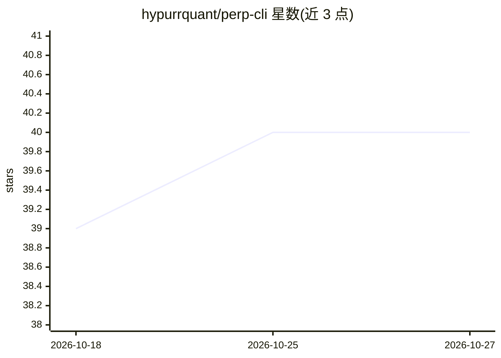

# hypurrquant/perp-cli

⭐ 40 · TypeScript · MIT · 推送 2026-10-26 · [GitHub](https://github.com/hypurrquant/perp-cli) · 组织维护

**多 DEX 永续合约交易 CLI，含 18 个 MCP 工具供 AI agent 调用**

Node.js 命令行工具，聚合 13 个永续合约与行情场所：Pacifica、Hyperliquid、Lighter、Aster、Lighter RH、Ondo Perps、Arcus、QFEX 可交易，RISEx/TxFlow/Variational/GRVT/Extended 仅行情，另含 Derive 期权数据（只读）。功能覆盖资金费率套利扫描与双腿执行、跨所组合查询、入出金与跨所划转、TWAP/网格/DCA/追踪止损机器人；提供 --json/--dry-run 等面向 agent 的输出与 MCP server（18 个工具）。密钥存于加密 OWS 钱包，导入密钥可完成交易但出金等操作需主钱包。npm 全局安装。

## 筛选速览

| 维度 | 判定 | 备注 |
|---|---|---|
| AI 角色 | `ai-enhanced` | 去掉 AI 部分产品仍成立 |
| 许可风险 | `permissive` | MIT |
| 部署形态 | `library` | 以包/库形式分发 |
| 模型依赖 | — | README 未给出锁定关系 |
| 硬件要求 | — | 无带数字的原话,不猜 |
| 安装摩擦 | `low` | 无编译、无系统依赖或容器化 |
| 成熟度 | `idea` | |

## 能力要点

- 8 个可交易场所 + 5 个行情场所 + Derive 期权只读数据
- 资金费率套利扫描与一键双腿执行
- TWAP/网格/DCA/追踪止损后台任务管理
- 18 个 MCP 工具与 --json/--ndjson/--dry-run agent 输出

## 适用场景

- 我在多个永续 DEX 间统一查仓位、下单和管理资金
- 我让 AI agent 通过 MCP 工具代为执行交易操作
- 我扫描并执行跨所资金费率套利

## 场景标签

`金融量化` · 领域:学习与行业

## 证据(README 行号)

> L7: Multi-DEX perpetual futures CLI — **Pacifica** (Solana), **Hyperliquid** (HyperEVM), **Lighter** (Ethereum), **Aster
> L24: - **Agent-First Design** — `--json`, `--fields`, `--ndjson`, `--dry-run`, runtime schema introspection

## 星数曲线

2026-10-18 39 → 2026-10-27 40（+1）

---
*卡片 v1 · prompt 1.4 · 生成 2026-10-25 · 置信度 mid · 依据 README sha `efe14abce9b6` · [字段定义](../../DATASET.md)*
