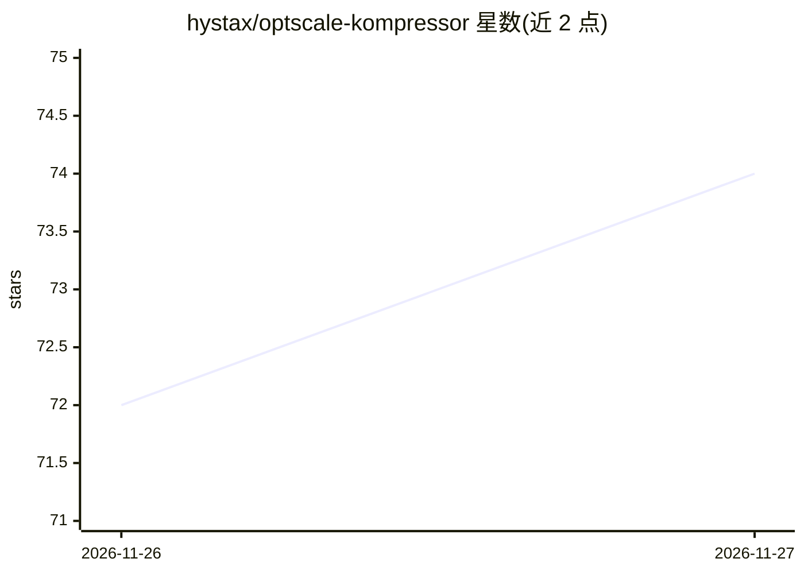

# hystax/optscale-kompressor

⭐ 74 · Rust · MIT · 推送 2026-11-25 · [GitHub](https://github.com/hystax/optscale-kompressor) · 组织维护

**给编程 agent 压缩提示词、降低 API 账单的本地代理**

单个 Rust 二进制，作为代理插在编程 agent 与模型提供方之间：确定性地压缩每轮重复发送的工具输出，被删内容可按需检索还原。对 Claude Code 有专门 Anthropic profile：只压缩未缓存尾部、工具运行期间每 4.5 分钟发 max_tokens:1 的保活请求维持缓存、按真实缓存计价。在 Codex 与 Claude Code 两个场景给出实测账单对比数据。经 wrap 命令包裹 Codex 等启动，本地运行。

## 筛选速览

| 维度 | 判定 | 备注 |
|---|---|---|
| AI 角色 | `ai-ecosystem` | LLM/agent 周边工具 |
| 许可风险 | `permissive` | MIT |
| 部署形态 | `desktop` | 安装包/桌面程序 |
| 模型依赖 | locked-api |  |
| 硬件要求 | — | 无带数字的原话,不猜 |
| 安装摩擦 | `low` | 无编译、无系统依赖或容器化 |
| 成熟度 | — | 结构信号不足 |

## 能力要点

- 确定性压缩：同一输入每轮压缩为相同字节，保持 prompt cache 有效
- 被删除的细节保持可检索还原
- Claude Code 专属 profile：尾部压缩、缓存保活、真实账单计价
- 单 Rust 二进制，本地运行

## 适用场景

- 降低 Codex/Claude Code 长任务下的 API 账单
- 避免长构建/训练后 prompt 缓存过期重写
- 控制 agent 会话的请求体积与上下文占用

## 场景标签

`编码 Agent` · 领域:编码与开发

## 证据(README 行号)

> L9: OptScale Kompressor sits between a coding agent and its model provider. It
> L20: kompressor wrap codex
> L68: Kompressor's Anthropic profile answers it in three parts:

## 星数曲线

2026-11-26 72 → 2026-11-27 74（+2）

---
*卡片 v1 · prompt 1.4 · 生成 2026-11-26 · 置信度 high · 依据 README sha `47f48cf24ec2` · [字段定义](../../DATASET.md)*
