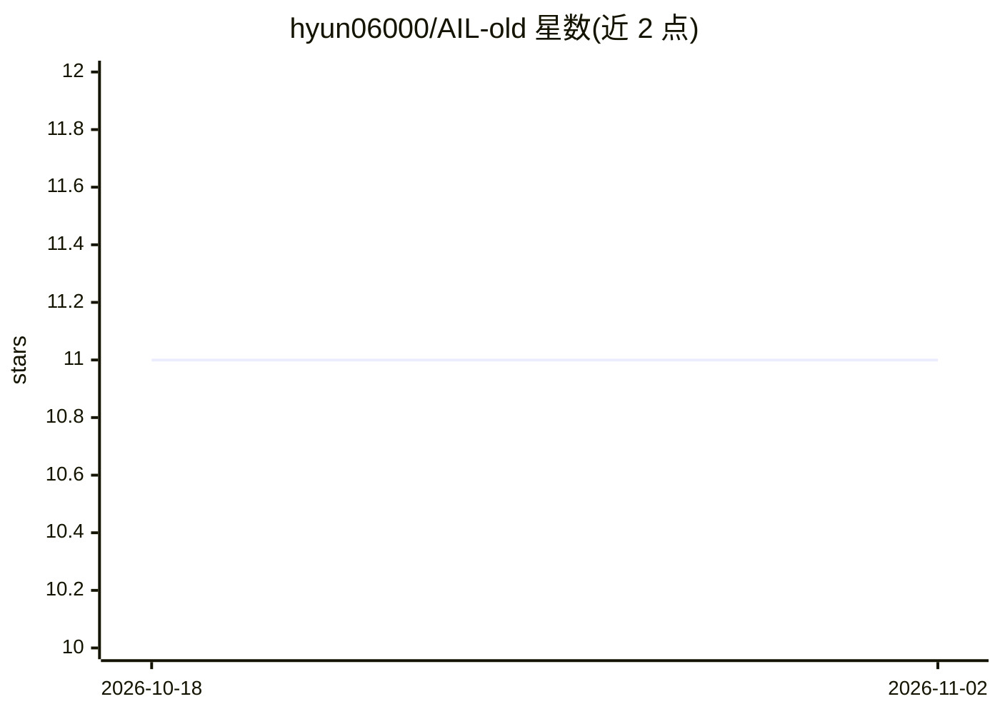

# hyun06000/AIL-old

⭐ 11 · Python · Apache-2.0 · 推送 2026-06-01 · [GitHub](https://github.com/hyun06000/AIL-old) · 个人维护 · 中文 README

**供 LLM 编写的安全优先编程语言（AIL）及其解释器**

AIL 是一门以 AI 为主要代码作者的编程语言，把安全约束放进语法本身：无 while 循环、纯函数禁止副作用（PurityError）、LLM 调用仅能经 intent 关键字显式表达。提供 pip 安装的解释器与 `ail up` 聊天界面，用户用自然语言描述目标，模型在页面内编写、测试并运行 .ail 程序，可部署常驻服务与长时自主 agent（调度、自我演化 evolve、ed25519 签名信件）。也可不安装、仅把参考卡粘贴给任意 LLM 直接读写 AIL。README 给出多组 AIL 与 Python 的对比评测数据。

## 筛选速览

| 维度 | 判定 | 备注 |
|---|---|---|
| AI 角色 | `ai-ecosystem` | LLM/agent 周边工具 |
| 许可风险 | `permissive` | Apache-2.0 |
| 部署形态 | `library` | 以包/库形式分发 |
| 模型依赖 | local-ok | 支持本地模型 |
| 硬件要求 | — | 无带数字的原话,不猜 |
| 安装摩擦 | `low` | 无编译、无系统依赖或容器化 |
| 成熟度 | — | 结构信号不足 |

## 能力要点

- 语法层面禁止无限循环、纯函数副作用与隐式 LLM 调用（intent 关键字为唯一模型调用通道）
- `ail up` 打开聊天页面，AI 编写、测试并运行 .ail 程序，支持部署常驻服务与热重载
- 长时自主 agent 脚手架：调度、优先级队列、预算上限、ed25519 签名 Stoa 信件
- 零安装路径：粘贴参考卡即可让任意 LLM（Claude/GPT/Gemini/本地模型）编写合法 AIL

## 适用场景

- 让 AI agent 以受语法约束的语言替我编写并运行自动化程序
- 搭建按调度运行、可自我演化的长时自主 agent
- 在无 API key 环境下用 Ollama 本地模型（ail-coder:7b-v3）驱动 AIL

## 场景标签

`代码生成` `编码 Agent` · 领域:编码与开发

## 证据(README 行号)

> L10: **A programming language where the dangerous things are grammatically impossible.**
> L14: You can do that because the agent does not write Python. It writes AIL — a language with no infinite loops, no sile
> L40: |**What it does**|Deterministic computation|Delegates to a language model|

## 星数曲线

2026-10-18 11 → 2026-11-02 11（+0）

---
*卡片 v1 · prompt 1.4 · 生成 2026-11-02 · 置信度 high · 依据 README sha `684d3155170b` · [字段定义](../../DATASET.md)*
