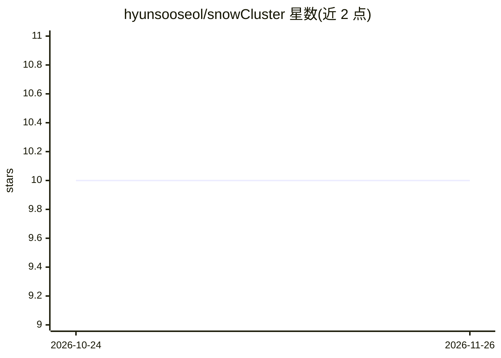

# hyunsooseol/snowCluster

⭐ 10 · R · GPL-3.0 · 推送 2026-09-27 · [GitHub](https://github.com/hyunsooseol/snowCluster) · [官网](http://www.sthda.com/english/wiki/factoextra-r-package-easy-multivariate-data-analyses-and-elegant-visualization) · 组织维护

**面向 jamovi 用户的聚类与多元统计分析模块**

由 snowsoft Inc. 开发维护的 jamovi 模块，属于其统计模块系列之一。提供 k-means 与层次聚类分析，并支持对主成分分析、对应分析、判别分析、决策树、多维尺度分析、多重因子分析、机器学习及 Prophet 时间序列分析的结果进行可视化。面向教育、科研与应用数据分析场景。

## 筛选速览

| 维度 | 判定 | 备注 |
|---|---|---|
| AI 角色 | `ai-native` | 本体是模型或模型工具 |
| 许可风险 | `viral` | GPL-3.0 |
| 部署形态 | `None` |  |
| 模型依赖 | — | README 未给出锁定关系 |
| 硬件要求 | — | 无带数字的原话,不猜 |
| 安装摩擦 | `low` | 无编译、无系统依赖或容器化 |
| 成熟度 | — | 结构信号不足 |

## 能力要点

- 提供 k-means 与层次聚类分析
- 支持 PCA、对应分析、判别分析、决策树、多维尺度、多重因子分析等多种多元统计方法的可视化
- 包含机器学习与 Prophet 时间序列分析工具
- 以 jamovi 模块形式分发

## 适用场景

- 在教学课程中演示聚类与降维分析方法
- 科研中对数据进行分类与聚类分析
- 对时间序列数据做 Prophet 预测分析

## 场景标签

`科研工具` · 领域:学习与行业

## 证据(README 行号)

> L3: `snowCluster` is a jamovi module developed and maintained by snowsoft Inc.
> L5: It is part of the snowsoft statistical module series for jamovi and provides clustering, classification, time series

## 星数曲线

2026-10-24 10 → 2026-11-26 10（+0）

---
*卡片 v1 · prompt 1.4 · 生成 2026-11-19 · 置信度 mid · 依据 README sha `c31e705400aa` · [字段定义](../../DATASET.md)*
