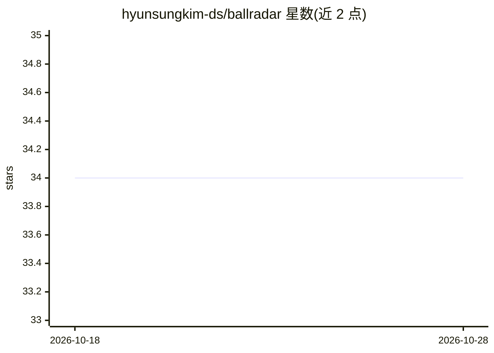

# hyunsungkim-ds/ballradar

⭐ 34 · Jupyter Notebook · 推送 2026-02-03 · [GitHub](https://github.com/hyunsungkim-ds/ballradar) · [官网](https://arxiv.org/abs/2306.08206) · 个人维护

**KDD 2023 论文代码：从球员轨迹推断足球比赛球体轨迹**

论文 Ball Trajectory Inference from Multi-Agent Sports Contexts Using Set Transformer and Hierarchical Bi-LSTM（KDD 2023）的官方源码。框架分层结构：球权持有者分类器预测每一时刻持球球员，球轨迹回归器以持球概率为条件预测最终球体轨迹；子模型使用 Set Transformer 获取多智能体上下文的置换不变/等变表示，用 Bi-LSTM 做序列推断，并做规则后处理。训练数据含不可共享的 Fitogether GPS 数据与公开的 Metrica 数据，可用 Metrica 数据复现。附 TraceAnimator 可视化工具。

## 筛选速览

| 维度 | 判定 | 备注 |
|---|---|---|
| AI 角色 | `ai-native` | 本体是模型或模型工具 |
| 许可风险 | `none` | — |
| 部署形态 | `library` | 以包/库形式分发 |
| 模型依赖 | — | README 未给出锁定关系 |
| 硬件要求 | — | 无带数字的原话,不猜 |
| 安装摩擦 | `low` | 无编译、无系统依赖或容器化 |
| 成熟度 | — | 结构信号不足 |

## 能力要点

- 持球者分类器 + 条件球轨迹回归器的分层模型
- Set Transformer 处理多智能体上下文的置换不变/等变表示
- 基于规则的后处理使输出更符合物理
- TraceAnimator 动态可视化比赛追踪数据

## 适用场景

- 从球员追踪数据推断缺失的球体轨迹
- 复现论文中的模型训练与评估
- 可视化与检验足球比赛追踪数据的预测结果

## 场景标签

 · 领域:体育分析/机器学习

## 证据(README 行号)

> L3: Source code for the paper Ball Trajectory Inference from Multi-Agent Sports Contexts Using Set Transformer and Hiera
> L6: **Ball Radar** is a framework for ball trajectory inference from player trajectories in soccer matches. The main mod

## 星数曲线

2026-10-18 34 → 2026-10-28 34（+0）

---
*卡片 v1 · prompt 1.4 · 生成 2026-10-25 · 置信度 mid · 依据 README sha `834aeed9a330` · [字段定义](../../DATASET.md)*
